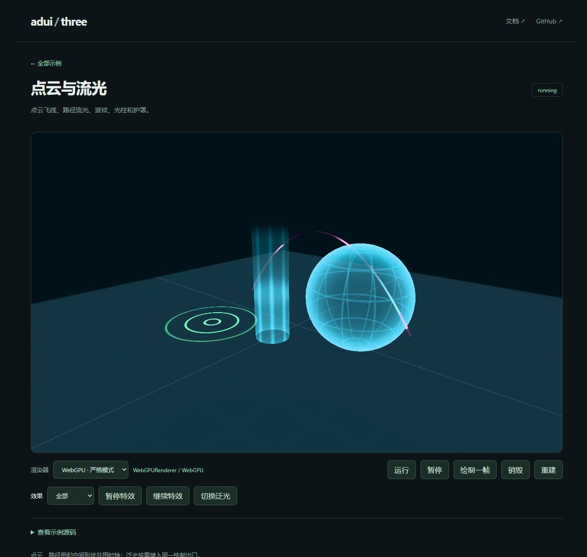

# @adui/three

面向应用开发的 Three.js 场景库。通过同一个 ThreeApp 创建 WebGL 或 WebGPU 场景，组合模型、动画、相机、交互和视觉效果，并统一管理帧循环、尺寸与资源释放。

[使用指南](docs/guide/getting-started.md) · [API 参考](docs/api/index.md) · [运行示例](examples/README.md) · [开发文档](docs/development/index.md)

> [!NOTE]
> 当前版本为 0.0.0，尚未发布 npm。ESM / TypeScript，基于 Three.js 0.187.0；peer 范围为 >=0.187.0 <0.188.0。可通过工作区或本地 tarball 接入。



同一套公开 API 在原生 WebGPU 中运行的实际示例画面。

## 快速开始

容器需要明确宽高。应用直接依赖 three@0.187.0，使用原生类型时另声明 @types/three@0.187.0；安装步骤见 [安装与版本](docs/guide/installation.md)。

```html
<div id="scene" style="width:100%;height:480px"></div>
```

```ts
import { ThreeApp } from "@adui/three";
import { attachOrbitControls } from "@adui/three/controls";
import { BoxGeometry, Mesh, MeshNormalMaterial } from "three";

const container = document.querySelector<HTMLElement>("#scene")!;
const app = await ThreeApp.create(container, {
  renderer: { type: "webgl", antialias: true }, // 也可选择 "webgpu"
  maxPixelRatio: 2,
});

const cube = new Mesh(
  app.resources.track(new BoxGeometry()),
  app.resources.track(new MeshNormalMaterial()),
);
app.scene.add(cube);
app.camera.lookAt(0, 0, 0);
attachOrbitControls(app);
app.onUpdate(({ delta }) => {
  cube.rotation.y += delta;
});
app.start();
```

创建完成后默认不运行。start / stop 控制连续渲染，renderOnce 绘制一帧而不推进动画；在组件或页面卸载时等待清理：

```ts
await app.destroy();
```

scene、camera、renderer 保留原生 Three.js 类型。只有登记到 resources 的资源由宿主释放；外部借用资产仍由其所有者管理。

## WebGL 与 WebGPU

两种后端使用相同的创建入口、生命周期和扩展 API。渲染器选择集中在 renderer 配置：

```ts
const app = await ThreeApp.create(container, {
  renderer: { type: "webgpu", allowFallback: false, antialias: true },
});
```

allowFallback 默认 true，允许 WebGPURenderer 使用其原生 WebGL 2 回退；false 要求原生 WebGPU，初始化不满足要求时拒绝 Promise。app.rendererType 表示渲染器族，app.backend 表示实际 webgl2 / webgpu。泛光、描边、滤镜、动态特效、阴影、环境、导航与截图沿用同一组函数；后处理统一通过 configure 调整。

透视宿主支持两种渲染器，正交宿主目前只支持 WebGL。GPUAdapter 由浏览器选择，不是额外 npm 包；自动化环境没有适配器，不代表使用者电脑缺显卡。完整契约、设备验证及原生对象差异见 [渲染器配置](docs/api/webgpu.md)。

## 能力与入口

| 领域       | 公开模块与文档                                                                                                                                     |
| ---------- | -------------------------------------------------------------------------------------------------------------------------------------------------- |
| 场景与资源 | [ThreeApp、OrthographicThreeApp、ResourceScope](docs/api/core.md)                                                                                  |
| 模型与动画 | [GLTF/GLB、Draco/Meshopt/KTX2](docs/api/loaders.md)、[动作控制与路径运动](docs/api/animation.md)                                                   |
| 相机与交互 | [取景与视角](docs/api/camera.md)、[拾取](docs/api/interaction.md)、[DOM 标签](docs/api/labels.md)、[控件](docs/api/controls.md)                    |
| 导航与几何 | [第一/第三人称](docs/api/navigation.md)、[BVH 碰撞](docs/api/collision.md)、[路径与实例化](docs/api/geometry.md)                                   |
| 视觉效果   | [八种动态特效](docs/api/effects.md)、[实时阴影](docs/api/lighting.md)、[泛光/描边/滤镜](docs/api/postprocessing.md)                                |
| 环境与输出 | [HDR/EXR/Room](docs/api/environment.md)、[图片/KTX2](docs/api/textures.md)、[色调与曝光](docs/api/rendering.md)、[截图与裁剪](docs/api/capture.md) |

17 个公开入口按需导入，内部路径不属于公开 API。库不依赖应用框架、Store 或固定 DOM 选择器。

## 本地开发

Node.js >=22.18.0，pnpm 12.16.1。在仓库根目录执行：

```sh
pnpm install --frozen-lockfile
pnpm run dev
```

打开终端显示的 /play/ 地址。9 个正式示例均可选择 WebGL、WebGPU 自动回退或严格 WebGPU，并显示实际后端；源码与运行画面来自同一个示例模块。

| 命令                    | 用途                                |
| ----------------------- | ----------------------------------- |
| pnpm run dev            | 正式示例与源码画廊                  |
| pnpm run docs:dev       | VitePress 使用指南、API 与内嵌示例  |
| pnpm run dev:playground | 回归工作台、场景导航与 GPU 能力诊断 |
| pnpm run docs:build     | 构建文档站及同一套示例              |
| pnpm run docs:preview   | 预览文档构建结果                    |

## 项目结构与验证

```text
packages/three/  可分发 SDK 与单元测试
examples/        正式示例与源码画廊
apps/docs/       VitePress 配置与主题
apps/website/    集成验证工作台
fixtures/        共享原创资产与许可记录
docs/            指南、API、设计与验收记录
tests/           浏览器、站点与独立包消费验证
```

```sh
pnpm run ready
pnpm run test:package
pnpm run test:browser
pnpm run test:site
```

验证范围与真实结果见 [Harness](docs/HARNESS.md)。代码边界见 [目录说明](docs/development/package-layout.md)，旧版接入见 [迁移指南](docs/MIGRATION.md)。

[贡献指南](CONTRIBUTING.md) · [MIT](LICENSE)
