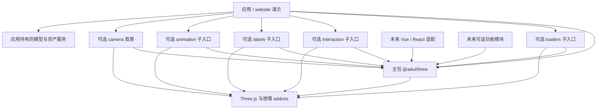

# 架构

## 当前架构

当前是 pnpm 工作区，根包 `adui-three` 为 private，只包含 `packages/three` 主库和 `apps/website` 原生 TS 双实例演示。未使用的 utils 模板包与 tools/* 占位声明已清理。主库基于 Three.js 0.187.0 / WebGL 2；没有框架适配、数据库、后端认证、共享资产缓存或后端服务。

已存在工具链：Vite+ 1.4.0，TypeScript 声明 ^7.0.2，Node 要求 >=22.18.0，包管理器声明 pnpm 12.16.1。版本事实来自配置与锁文件，不代表新库兼容范围。[代码地图](CODEBASE_MAP.md) 定位现有文件。

## 目标与建议边界

主 npm 包名 `@adui/three` 已确认。原始边界提案保留在 [ADR-0001](adr/0001-package-boundaries.md)，已实施的版本、模块和生命周期决策见 [ADR-0002](adr/0002-core-mvp.md)。不创建空扩展包。

模型子入口的异步取消与资源快照决策见 [ADR-0003](adr/0003-gltf-lifecycle.md)。

模型扩展 scope、动画双范围生命周期与原生事件重入见 [ADR-0004](adr/0004-animation-lifecycle.md)。

Draco 任务所有权、借用 Meshopt 与本地解码资源决策见 [ADR-0005](adr/0005-compressed-models.md)。

KTX2 的能力检测、缓冲复制、在途转码与纹理移交见 [ADR-0006](adr/0006-ktx2-lifecycle.md)。

相机取景与 OrbitControls 同步见 [ADR-0007](adr/0007-camera-framing.md)。

单主包用内部模块组合宿主、调度、尺寸与资源归属；宿主暴露原生 Three.js 对象，演示依赖公开入口。OrbitControls 从 controls、GLTF/GLB 从 loaders、拾取从 interaction、DOM 标签从 labels、模型动画从 animation 子入口接入；核心默认入口不依赖这些可选模块。标签在渲染完成阶段同步投影；动画在统一更新阶段驱动 Mixer，绑定宿主与模型扩展 scope，均无第二循环。animation 对 GLTFModel 仅有类型引用，loader 不导入动画或自动播放。后处理留后续。Vue/Pinia、业务解密和场景路径不进入核心。

截图中 `@adui/three-utils`、`@adui/three-effects`、`@adui/three-controls`、`@adui/three-gis`、`@adui/three-editor`、`@adui/three-vue`、`@adui/three-react` 仅记录为未来可能命名，不视为已批准拆包。

camera 为无独立调度/资源的即时计算与应用入口，仅按类型借用 ThreeApp 和 OrbitControls；默认核心不依赖取景。应用选择目标、触发时机及暂停时的绘制策略。

## 关键取舍

- 保留现有 Monorepo 与工具链；公共能力先在主包中按职责组织，出现独立复用需求再拆包。
- 单一 RAF 更新模块并统一 render；用 epoch 隔离旧调度，WebXR 不在支持范围。实现契约见 [SDD](SDD.md)。
- Three.js peer 范围 >=0.187.0 <0.188.0，开发版本固定 0.187.0；类型包作为 dependency 随库安装。ESM/ES2022 与声明由 Vite+ pack 生成，Three.js/addons 保持外部依赖。development 导出指向随包包含的 src。
- 资源所有权显式区分库创建与外部借用；不能把 scene 中所有对象无条件释放。
- 先给出最小可用核心；多 renderer、插件系统、依赖注入容器、编辑器协议不提前固化。

## 数据流与运行边界

压缩解码在 loaders 选项中按需接入；Draco 为任务自有对象，直到底层 Promise 结束才释放，Meshopt 模块由应用借用。KTX2 内部适配层按 renderer 检测能力，复制输入隔离原生全局纹理缓存，原生模型完成及已开始解析全部结束后释放转码器；已移交纹理由模型快照释放，失败未移交纹理单独回收。库不持有全局解码池或业务资产服务。

编码器仅用于开发：Draco/Meshopt 为根开发依赖，Basis WASM 编码工具固定官方提交及字节哈希、缓存于忽略目录，首次重建需网络，暖缓存可离线。演示用 Vite 从 Three.js 依赖输出本地文件，许可证随 public 分发；主包产物仍不内联 Three.js/addons 或二进制。

应用传入容器和配置 → 宿主建立场景/相机/渲染器 → 绑定尺寸和可见性监听 → 应用 start → 主循环更新并渲染 → 应用卸载时释放。GPU 和 DOM 资源与实例绑定；借用资源由外部管理。模型通过独立 loadGLTF 任务创建并由返回句柄拥有；逻辑取消与迟到清理绑定宿主/调用方 signal，不中止可能共享的运输。

build 构建主库 ESM/声明和 website；浏览器回归以生产构建演示验证真实 WebGL。npm 发布和站点部署未执行。无内置私有资产服务、Stats 或遥测；帧异常停止后抛出，清理异常聚合报告。

## 风险与维护

主要风险来自旧版业务耦合、资源归属不清、多个动画循环、版本兼容和第三方源码来源。[旧版审查](LEGACY_REVIEW.md) 提供证据与候选验收。

模块边界、选型、集成或部署方案变化时更新本文件；重大决策新增 ADR，接口细节维护在 SDD。ADR-0001 保留历史 Proposed 状态，ADR-0002 记录当前 Accepted MVP 决策。
