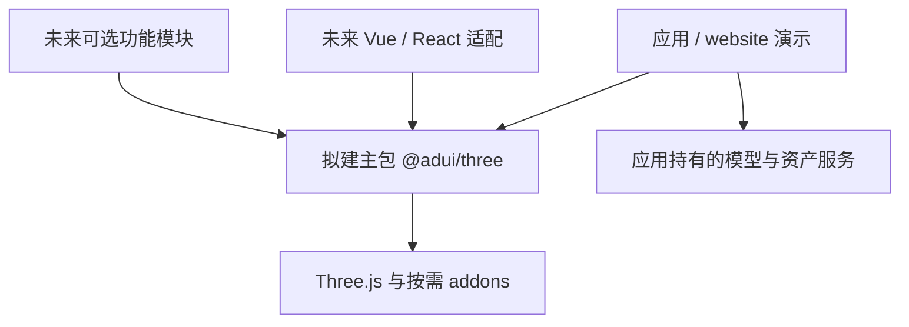

# 架构

## 当前架构

当前是 pnpm 工作区，根包 `adui-three` 为 private，包含 `apps/website` 和 `packages/utils`。website 是原生 TypeScript Vite 模板；utils 只有返回问候字符串的 fn 和示例测试。工作区声明 tools/*，但当前无该目录。尚无 Three.js、框架适配、数据库、认证、缓存或后端服务。

已存在工具链：Vite+ 1.4.0，TypeScript 声明 ^7.0.2，Node 要求 >=22.18.0，包管理器声明 pnpm 12.16.1。版本事实来自配置与锁文件，不代表新库兼容范围。[代码地图](CODEBASE_MAP.md) 定位现有文件。

## 目标与建议边界

主 npm 包名 `@adui/three` 已确认；以下组织方式为 Proposed，见 [ADR-0001](adr/0001-package-boundaries.md)。不预先创建空包或改名 utils。

建议从单一主包开始，用内部模块组合宿主、调度、尺寸和资源管理，按实际使用量再拆包。宿主暴露必要 Three.js 对象以便原生扩展，避免重造全部 Three.js API；演示依赖公开入口。模型、标签、控制、后处理按需接入；Vue/Pinia、业务解密和场景路径不进入核心依赖。

截图中 `@adui/three-utils`、`@adui/three-effects`、`@adui/three-controls`、`@adui/three-gis`、`@adui/three-editor`、`@adui/three-vue`、`@adui/three-react` 仅记录为未来可能命名，不视为已批准拆包。

## 关键取舍

- 保留现有 Monorepo 与工具链，减少初始化变更；是否复用 utils 需等真实公共函数出现再决定。
- 建议由一个帧循环更新所有模块，并由同一出口渲染，避免旧版重复渲染。实现契约见 [SDD](SDD.md)。
- 建议 Three.js 采用 peer dependency，降低消费端出现多份实例的风险；具体版本、类型依赖、导出格式和外部化配置未选定。
- 资源所有权显式区分库创建与外部借用；不能把 scene 中所有对象无条件释放。
- 先给出最小可用核心；多 renderer、插件系统、依赖注入容器、编辑器协议不提前固化。

## 数据流与运行边界

建议：应用传入容器和配置 → 宿主建立场景/相机/渲染器 → 尺寸协调器监听容器 → 主循环更新模块并渲染 → 应用卸载时逆序释放。异步资产结果进入场景前检查宿主状态；GPU 和 DOM 资源生命周期与实例绑定。

库构建产物、npm 发布和演示站点部署均尚未实现为产品流程。当前 build 仅构建模板两包。资源 URL 及加载权限交由应用；无内置私有资产服务。诊断建议先提供错误传播和可选回调，避免在核心强制引入 Stats、遥测和全局日志。

## 风险与维护

主要风险来自旧版业务耦合、资源归属不清、多个动画循环、版本兼容和第三方源码来源。[旧版审查](LEGACY_REVIEW.md) 提供证据与候选验收。

模块边界、选型、集成或部署方案变化时更新本文件；重大决策新增 ADR，接口细节维护在 SDD。当前唯一 ADR 中，包名为 Accepted 事实，模块方案为 Proposed。
