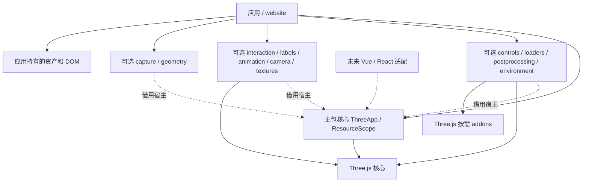

# 架构

## 当前架构

当前是 pnpm 工作区，根包 `adui-three` 为 private，只包含 `packages/three` 主库和 `apps/website` 原生 TS 双实例演示。未使用的 utils 模板包与 tools/* 占位声明已清理。主库基于 Three.js 0.187.0 / WebGL 2；没有框架适配、数据库、后端认证、自建共享资产缓存或后端服务。

已存在工具链：Vite+ 1.4.0，TypeScript 声明 ^7.0.2，Node 要求 >=22.18.0，包管理器声明 pnpm 12.16.1。版本事实来自配置与锁文件，不代表新库兼容范围。[代码地图](CODEBASE_MAP.md) 定位现有文件。

单次绘制向 capture 返回是否已同步调用 renderer/pipeline；capture 不接受未发生绘制的旧缓冲。该结果不验证第三方管线是否正确输出或 GPU 完成，原生画布检查和任务所有权仍由既有层分别负责。

## 目标与建议边界

路径有限循环由既有 path-animation 更新内的有界 phase/剩余程数处理，无独立调度；目标借用与作用域清理保持，见 [ADR-0034](adr/0034-path-repetitions.md)。

路径定位继续位于 animation 内部 path-animation 模块，通过既有目标写锁和候选采样复用 followPath；只在控制命令时定位/暂停，不新增调度或对象所有权，见 [ADR-0033](adr/0033-path-seek.md)。

geometry 的 computeObjectBounds 与 camera 的两类取景共用内部 [object-bounds.ts](../packages/three/src/object-bounds.ts)，只依赖原生 CPU 数学和对象，测量不借用宿主或 addon。原生矩阵/边界缓存会同步，返回独立世界 Box3，不接管对象资源，见 [ADR-0032](adr/0032-object-bounds.md)。

主 npm 包名 `@adui/three` 已确认。原始边界提案保留在 [ADR-0001](adr/0001-package-boundaries.md)，已实施的版本、模块和生命周期决策见 [ADR-0002](adr/0002-core-mvp.md)。不创建空扩展包。

模型子入口的异步取消与资源快照决策见 [ADR-0003](adr/0003-gltf-lifecycle.md)。

模型扩展 scope、动画双范围生命周期与原生事件重入见 [ADR-0004](adr/0004-animation-lifecycle.md)。

Draco 任务所有权、借用 Meshopt 与本地解码资源决策见 [ADR-0005](adr/0005-compressed-models.md)。

KTX2 的能力检测、缓冲复制、在途转码与纹理移交见 [ADR-0006](adr/0006-ktx2-lifecycle.md)。

相机取景与 OrbitControls 同步见 [ADR-0007](adr/0007-camera-framing.md)。

单主包用内部模块组合宿主、调度、尺寸与资源归属；宿主暴露原生 Three.js 对象，演示依赖公开入口。OrbitControls 从 controls、GLTF/GLB 从 loaders、拾取从 interaction、DOM 标签从 labels、模型动画从 animation 子入口接入；核心默认入口不依赖这些可选模块。标签在渲染完成阶段同步投影；动画在统一更新阶段驱动 Mixer，绑定宿主与模型扩展 scope，均无第二循环。animation 对 GLTFModel 仅有类型引用，loader 不导入动画或自动播放。可选 postprocessing 使用宿主独占管线，固定基础渲染、可选描边/泛光和输出转换，不创建新调度；其余效果留后续。Vue/Pinia、业务解密和场景路径不进入核心。

截图中 `@adui/three-utils`、`@adui/three-effects`、`@adui/three-controls`、`@adui/three-gis`、`@adui/three-editor`、`@adui/three-vue`、`@adui/three-react` 仅记录为未来可能命名，不视为已批准拆包。

camera 提供即时规划/应用以及可取消平滑过渡，仅按类型借用 ThreeApp 和 OrbitControls；默认核心不依赖取景。过渡复用宿主更新并登记清理句柄，无独立调度；应用选择目标、触发时机及绘制/启停策略。内部模块共享相机写入锁和过渡弱引用登记，见 [ADR-0008](adr/0008-camera-transition.md)。

核心绘制阶段允许借用一个 RenderPipeline，统一同步尺寸/DPR 并替代默认渲染；单次 render 也复用管线与完成阶段。核心不导入后处理 addon，资源由模块的 scope 持有，见 [ADR-0009](adr/0009-render-pipeline.md)。

泛光资源和渲染期销毁见 [ADR-0010](adr/0010-bloom-lifecycle.md)。HalfFloat composer 目标由模块拥有，renderer/场景借用；可选入口保持 addon 外部化，核心不反向依赖效果。

组合效果与场景异常恢复见 [ADR-0011](adr/0011-effect-composition.md)，attachBloom 继续兼容，未指定效果不分配；选择状态与模型存活仍由消费者管理。

controls 的变换手柄复用原生 TransformControls，仅拥有 helper/监听及初始 GPU 快照，目标与 OrbitControls 借用；不构成编辑器或场景序列化服务。资源与输入协调见 [ADR-0013](adr/0013-transform-controls.md)。

textures 是可选独立图片入口，FileLoader 合并不可变字节，浏览器 createImageBitmap 逐任务解码；TextureAsset 显式拥有纹理和位图，材质/场景由消费者借用。无共享位图缓存、自动材质修改或默认核心反向导入，见 [ADR-0014](adr/0014-image-textures.md)。

animation 的 seek 复用既有 Mixer、队列与零 delta 采样，定位与场景绘制分离，保持单一调度及模型/宿主所有权，见 [ADR-0015](adr/0015-animation-seek.md)。

宿主尺寸错误恢复分别维护原生缓冲和管线的待同步状态，绘制前完成重试，并保护尺寸操作中的递归调用；不改变资源所有权或增加调度，补充 ADR-0009 的失败契约。

独立 KTX2 从 textures 导出，内部与模型加载共享 TaskKTX2Loader 的隔离/在途清理适配层，不依赖 GLTFLoader 或模型句柄；原生压缩资产和图片位图资产分开拥有，见 [ADR-0016](adr/0016-standalone-ktx2.md)。

动画渐变仍只在宿主更新中对原生 action 权重采样；中断用有效权重快照，原生 Mixer 返回后才退役旧动作，保持模型/宿主双范围所有权，见 [ADR-0017](adr/0017-animation-crossfade.md)。

## 关键取舍

模型级运行倍速使用现有 Mixer.timeScale，GLTFAnimationsHandle 的 setter 复用播放命令队列；全部动作和渐变使用同一模型时钟，不增加调度或动作所有者。动作级 timeScale 仍独立，见 [ADR-0036](adr/0036-animation-playback-rate.md)。

区域截图只改变 capture 的同步复制矩形，使用相同宿主绘制、pending 所有权和编码流程；不增加渲染目标、调度器或图像服务，见 [ADR-0031](adr/0031-capture-region.md)。

环境入口的 loadHDR/loadEXR 共用任务与资产生命周期，仅原生解码器不同；EXR 为每任务复制输入，绑定/原生转换缓存仍由既有所有权管理。不创建格式服务或新入口，见 [ADR-0030](adr/0030-exr-environment.md)。

camera-view 保存与恢复相机的数值配置，camera-view-transition 复用其预检，并与取景过渡共享 camera-runtime 写锁/单相机登记。平滑恢复订阅既有宿主更新；不创建第二调度、存储服务或场景序列化。快照不拥有原宿主/控件/模型，细节见 [ADR-0029](adr/0029-camera-views.md) 和 [ADR-0035](adr/0035-camera-view-transition.md)。

透视/正交过渡共用 camera-transition 的内部泛型执行器，正交规划与即时应用共用 prepareOrthographicFrame。生命周期与输入租约保持单一实现，核心无反向依赖，见 [ADR-0028](adr/0028-orthographic-transition.md)。

正交取景在 camera 子入口以独立函数提供，两种相机共享内部精确世界边界/蒙皮准备与相机写锁；默认核心不依赖规划。应用只写原生姿态/zoom/裁剪面，控件借用且不改变约束，不增加调度，见 [ADR-0027](adr/0027-orthographic-framing.md)。

ThreeApp 与 OrthographicThreeApp 共用内部 SceneHost 生命周期，公开保留各自具体相机类型，通用可选模块通过 AnyThreeApp 借用；核心不导出内部基类，不接受外部注入或动态换相机。正交尺寸策略及透视取景边界见 [ADR-0026](adr/0026-orthographic-host.md)。

capture 是不含运行时 Three.js/addon 依赖的可选入口，复用宿主单次绘制、借用 canvas 并拥有独立 Canvas 2D 编码面；完成返回 Blob，预览 URL/下载由消费者管理。默认核心不反向导入，见 [ADR-0021](adr/0021-frame-capture.md)。

拾取入口在 CPU 查询时可刷新蒙皮边界和骨骼矩阵，保持原生 Raycaster、显式借用目标及无额外调度；应用可关闭刷新以使用自有边界策略，见 [ADR-0020](adr/0020-skinned-picking.md)。

上下文丢失时结束该宿主，使用既有 abort 和所有权清理通知应用显式重建；不透明替换 renderer 或清借用资产，也不自动恢复旧 GPU 图。跨宿主实例继续保留其租约，见 [ADR-0019](adr/0019-context-loss.md)。

loaders 的 cloneGLTF 显式创建默认场景实例；内部将局部节点/骨骼与共享资产快照分离，源模型/实例各持租约，最后一个使用者才清共享 GPU 和图像。动画入口仅按类型接受模型或实例；不导入 loader 实现、不创建 URL 缓存或自动播放，见 [ADR-0018](adr/0018-gltf-instances.md)。

environment 是独立可选入口，下载/解码后的 HDR 资产由宿主拥有，场景绑定借用资产并同时登记两方清理。加载不改变场景；应用决定请求版本及绑定/绘制时机。复用 renderer 自动环境转换，不反向导入 website 或重复生成 PMREM，见 [ADR-0012](adr/0012-hdr-environment.md)。

- 保留现有 Monorepo 与工具链；公共能力先在主包中按职责组织，出现独立复用需求再拆包。
- 单一 RAF 更新模块并统一 render；用 epoch 隔离旧调度，WebXR 不在支持范围。实现契约见 [SDD](SDD.md)。
- Three.js peer 范围 >=0.187.0 <0.188.0，开发版本固定 0.187.0；类型包作为 dependency 随库安装。ESM/ES2022 与声明由 Vite+ pack 生成，Three.js/addons 保持外部依赖。development 导出指向随包包含的 src。
- 消费者直接导入 Three.js 时自行声明 three 与 @types/three，库的类型依赖只保证自身声明可解析。独立打包验证在工作区外安装 tarball，不依赖 website 的类型提升或开发导出，见 Harness。
- 资源所有权显式区分库创建与外部借用；不能把 scene 中所有对象无条件释放。
- 先给出最小可用核心；多 renderer、插件系统、依赖注入容器、编辑器协议不提前固化。

## 数据流与运行边界

压缩解码在 loaders 选项中按需接入；Draco 为任务自有对象，直到底层 Promise 结束才释放，Meshopt 模块由应用借用。KTX2 内部适配层按 renderer 检测能力，复制输入隔离原生全局纹理缓存，原生模型完成及已开始解析全部结束后释放转码器；已移交纹理由模型快照释放，失败未移交纹理单独回收。库不持有全局解码池或业务资产服务。

编码器仅用于开发：Draco/Meshopt 为根开发依赖，Basis WASM 编码工具固定官方提交及字节哈希、缓存于忽略目录，首次重建需网络，暖缓存可离线。演示用 Vite 从 Three.js 依赖输出本地文件，许可证随 public 分发；主包产物仍不内联 Three.js/addons 或二进制。

应用传入容器和配置 → 宿主建立场景/相机/渲染器 → 绑定尺寸和可见性监听 → 应用 start → 主循环更新并渲染 → 应用卸载时释放。GPU 和 DOM 资源与实例绑定；借用资源由外部管理。模型通过独立 loadGLTF 任务创建并由返回句柄拥有；逻辑取消与迟到清理绑定宿主/调用方 signal，不中止可能共享的运输。

build 构建主库 ESM/声明和 website；浏览器回归以生产构建演示验证真实 WebGL。npm 发布和站点部署未执行。无内置私有资产服务、Stats 或遥测；帧异常停止后抛出，清理异常聚合报告。

geometry 是可选的原生实例化网格管理入口：依赖核心的宿主类型和 ResourceScope，借用几何体/材质，拥有节点及实例属性；无循环、无反向应用依赖。见 [ADR-0022](adr/0022-managed-instancing.md)。

动画的有限循环和往返仍在原生 Mixer/Action 内调度；r187 的末帧修正仅在原生迭代返回后通过公开动作接口及零 delta 采样完成，不读取私有循环计数或创建新调度。见 [ADR-0023](adr/0023-animation-loops.md)。

对象路径运动继续使用 animation 子入口，只依赖原生向量/四元数及核心宿主类型。借用目标与 Curve，可选通用 ResourceScope 关联模型所有者；没有对加载器、应用或业务路径的运行时依赖。见 [ADR-0024](adr/0024-path-motion.md)。

模型动画的公共 loop/finished 通知位于原生采样和端点/权重收尾之后、宿主绘制之前，不新增渲染阶段或调度。原生 Mixer 事件仍留作低层观察，公共订阅与控制队列绑定模型/宿主生命周期，见 [ADR-0025](adr/0025-animation-notifications.md)。

## 风险与维护

主要风险来自旧版业务耦合、资源归属不清、多个动画循环、版本兼容和第三方源码来源。[旧版审查](LEGACY_REVIEW.md) 提供证据与候选验收。

模块边界、选型、集成或部署方案变化时更新本文件；重大决策新增 ADR，接口细节维护在 SDD。ADR-0001 保留历史 Proposed 状态，ADR-0002 记录当前 Accepted MVP 决策。
