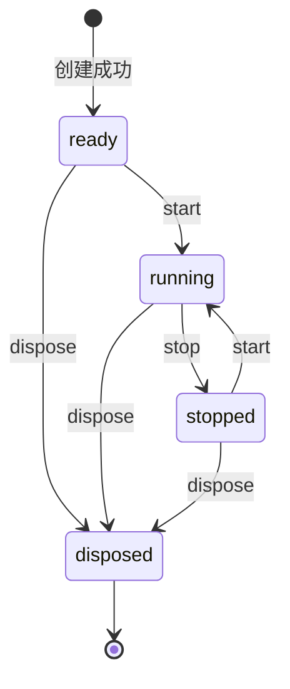

# 详细设计与实现契约

## 当前实现

当前产品库没有实现。现有 utils 的 fn 返回字符串，website 展示计数器，两者没有依赖关系。不得把下述草案当作可导入 API 或已交付功能。

## 建议设计（待决策）

建议主包未来放在 packages/three（目录尚未创建），名称 `@adui/three`。采用宿主加内部组合模块，初期无需通用插件框架。

| 建议职责     | 输入与输出                                           | 边界                                              |
| ------------ | ---------------------------------------------------- | ------------------------------------------------- |
| 场景宿主     | 容器、配置 → 场景/相机/渲染器访问与生命周期方法      | 不访问应用 Store，不查找全局固定容器              |
| 帧调度       | 时间戳 → delta/elapsed、更新回调                     | 唯一 RAF；订阅返回取消函数；停止/重启重置计时基准 |
| 尺寸协调     | 容器实际尺寸、DPR → 相机/renderer/可选 composer 尺寸 | 尺寸变化才更新；零尺寸暂停有效渲染；DPR 上限可配  |
| 资源登记     | 创建资源、所有权 → 释放句柄                          | 自有资源释放；借用资源由调用方负责；共享资源去重  |
| 后续资产模块 | URL、加载选项 → 模型与释放句柄                       | 不默认改写材质，不携带解密环境变量                |

候选 API 仅列语义：创建宿主、start、stop、resize、订阅更新、dispose。类名、工厂名、同步/异步构造方式、错误类型、公开属性与默认值需在实现任务中确定并补完整 TypeScript 签名；当前不提供虚假的可运行示例。

## 生命周期草案

候选契约：重复 start 不增加 RAF；重复 stop/dispose 幂等；disposed 后 start 抛状态错误；构造失败逆序清理已创建资源。dispose 先标记结束并取消调度，再撤销订阅/observer、卸载模块、释放自有 GPU 资源和 DOM；单个清理失败仍继续其余清理，最终返回或报告聚合错误，形式待定。

帧顺序建议为：计算以秒计的 delta → 控制器/动画/模块 update → 唯一 WebGL 或 composer render → 可选 CSS render。订阅顺序和异常策略需在 API 定稿时明确；暂停恢复不累计隐藏期间的巨大 delta。模块不得自行调用宿主 renderer 形成第二条渲染链。

## 关键边界与异常草案

- Resize：使用传入容器的尺寸；零宽高不除零，不每帧 setSize；DPR 变化的检测方案实现时决定。
- 拾取：若纳入范围，以实例容器 getBoundingClientRect 换算坐标；不读取全局缩放 Store；CSS transform 和嵌套容器需要集成验证。
- 模型：加载完成前宿主已销毁或任务已取消时，不加入场景，释放本次加载自有资源；不承诺底层 loader 必然能中断网络传输。
- 多实例：每个实例独立状态与事件；借入的纹理/材质由所有者管理；不能遍历 scene 后无差别 dispose。
- 标签：核心只接收 DOM 或可显式清理的挂载适配器；Vue 挂载必须有对应卸载，不把 render(vnode) 写进通用核心。
- 安全：不内置凭据和远程代码执行；资产授权由应用决定；本库没有数据库事务或服务端权限模型。

## 验证设计

生命周期与调度用可控制时钟/RAF 验证状态转换和去重；资源测试验证释放顺序、共享对象、失败继续清理与取消竞争。浏览器集成验证真实 resize、坐标、多实例和卸载残留；实际 GPU 场景另做手动或自动浏览器测试。不要用全 mock 的 renderer 单元测试宣称画面正确。

帧率和内存基准需先固定设备、模型和视口。尚未安装浏览器测试工具或创建以上测试；当前只有文档校验测试和模板测试。

## 需求追踪

| 需求    | 设计位置                     | 当前实现/证据                  | 验收方式                            |
| ------- | ---------------------------- | ------------------------------ | ----------------------------------- |
| FR-001  | 当前实现、工程文档与 Harness | AGENTS、docs、scripts 文档检查 | docs:test、docs:check 与人工审阅    |
| FR-002  | 建议设计、生命周期、关键边界 | 未实现                         | MVP 定稿后补编号和行为测试          |
| FR-003  | 建议设计与 ADR-0001          | 主包未创建                     | 后续核对包名、exports、演示公开入口 |
| NFR-001 | 需求追踪                     | 文档校验器与 Harness 结果      | 编号/状态/链接静态检查及语义审阅    |

## 维护

接口、数据结构、核心算法、生命周期或错误契约变化时更新。新增正式需求需加入追踪；实现后将对应段落从草案改为事实并链接具体代码和测试，不仅修改状态标签。
