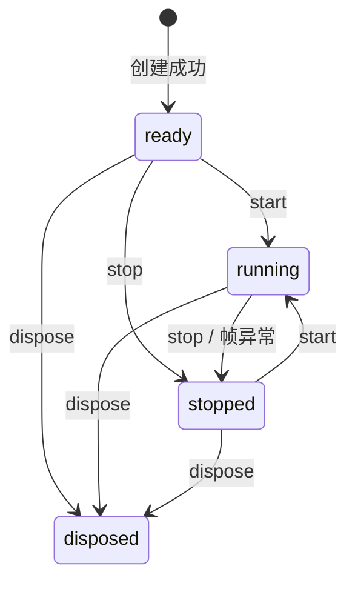

# 详细设计与实现契约

## 当前实现

核心位于 [packages/three](../packages/three/package.json)，提供 `ThreeApp`、`ResourceScope` 和类型；可选 `attachOrbitControls` 位于 controls 子入口。website 使用工作区公开入口。未引用的初始化模板包和素材已删除；现有工程模板、Skills 与文档校验继续使用。

核心决策见 [ADR-0002](adr/0002-core-mvp.md)，模型阶段见 [ADR-0003](adr/0003-gltf-lifecycle.md)。完整选项、默认值和示例以 [主包 README](../packages/three/README.md) 与导出类型为准；当前提供 GLTF/GLB 加载，尚无 composer、标签、寻路、框架适配或 WebGPU 实现。

## 核心 API

| 公开接口                                                | 具体职责与契约                                                                |
| ------------------------------------------------------- | ----------------------------------------------------------------------------- |
| `new ThreeApp(container, options?)`                     | 浏览器容器必需，创建自有 scene/camera/renderer/canvas，参数先校验，不自动启动 |
| `scene/camera/renderer`                                 | 原生对象的只读引用；不支持替换对象或额外并行渲染循环                          |
| `start()/stop()`                                        | 幂等启停；销毁后 start 抛错、stop 无操作                                      |
| `onUpdate((frame: FrameInfo) => void)`                  | 返回取消函数；按注册顺序同步执行；同一函数可多次独立订阅                      |
| `resize()` / `size`                                     | 从容器 clientWidth/clientHeight 与 DPR 获取尺寸；size 返回快照                |
| `resources.track<T extends Disposable>(resource: T): T` | 显式接管，scope 内按引用去重，不遍历 scene                                    |
| `resources.untrack(resource): boolean`                  | 归还所有权，不 dispose                                                        |
| `dispose()` / `signal`                                  | 幂等结束生命周期；signal 同步 abort；清理失败最终抛 AggregateError            |
| `attachOrbitControls(app)`                              | controls 独立入口，返回原生 controls 与 dispose，随宿主统一更新和释放         |

默认 fov=50、near=0.1、far=1000、position=[3,2,5] 并看向原点，maxPixelRatio=2、maxDelta=0.1 秒；renderer 默认 antialias=true，配置不接受外部 canvas/context。范围数值必须正且有限，fov<180、far>near，位置为三个有限数值。

## 模块与关键流程

| 模块     | 实现                                                 | 关键边界                                           |
| -------- | ---------------------------------------------------- | -------------------------------------------------- |
| 宿主     | [three-app.ts](../packages/three/src/three-app.ts)   | 实例状态、平台监听、统一 render、构造失败回滚      |
| 帧调度   | [frame-loop.ts](../packages/three/src/frame-loop.ts) | 单 RAF、epoch 失效、delta 计时与限幅、回调内重启   |
| 资源归属 | [resources.ts](../packages/three/src/resources.ts)   | 显式登记、逆序去重、聚合异常、清理前先终止 scope   |
| 控制器   | [controls.ts](../packages/three/src/controls.ts)     | 可选依赖，不创建额外循环，手动移除与宿主释放不重复 |

创建过程：校验容器/配置/ResizeObserver → 创建 scene/camera/renderer → 挂 canvas → 绑定 observer、窗口 resize、文档 visibility 和 DPR 媒体查询 → 初始 resize。后续步骤失败则调用 dispose 回滚；回滚异常与原错误聚合。

帧过程：检查 epoch → 计算 delta 和 elapsed → 拍摄订阅快照 → 逐个同步 update → 状态/代次仍有效时 render → 若仍属当前运行代次安排下一帧。新订阅下一帧开始，取消订阅在当前帧生效。更新或 render 异常先 stop，再重新抛给浏览器。

running 是用户运行意图；文档隐藏或容器零尺寸时暂停 RAF 但仍为 running，恢复自动调度。每次恢复首帧 delta=0；elapsed 累计有效帧中经 maxDelta 限幅的秒数，暂停期间不计入。宽高或 DPR 变化时才 setDrawingBufferSize 和更新投影；无效尺寸保留之前的合法投影，避免除零。DPR 由 matchMedia 变化和窗口 resize 检测，媒体监听变化时重新绑定。

## 释放与边界

销毁顺序：标记 disposed → 停止帧与 abort signal → 清订阅 → 撤 observer/平台监听 → 逆序释放显式资源 → scene.clear（只 detach）→ renderer.dispose → forceContextLoss → 移除自有 canvas。各步骤异常不影响后续步骤，最终 AggregateError；重复 dispose 不重试失败项。

资源 scope 内按对象引用去重；借入或跨实例共享资源留给外部所有者，不由某个实例独占登记。登记 Mesh 不自动接管其 geometry/material/texture。textures 需单独登记；材质释放不隐含纹理释放。scope 销毁后 track 抛错，untrack 只解除登记。异步业务应检查 signal 并自行清理迟到结果；本轮无模型加载或网络中断契约。

容器尺寸基于 clientWidth/clientHeight，建议无 padding，CSS transform 不改变绘制分辨率。构造仅限现代浏览器，要求 WebGL 2 / ResizeObserver / matchMedia；模块导入不访问 DOM。没有数据库、事务、后端鉴权或隐式遥测；资产权限由应用负责。

## GLTF / GLB 异步契约

[loaders.ts](../packages/three/src/loaders.ts) 为独立公开子入口，导出 `loadGLTF(app, url, options?): Promise<GLTFModel>`、LoadGLTFOptions、GLTFModel、ModelProgress。返回原生 scene/gltf、disposed 和 dispose；默认挂载，可 addToScene=false，保留原始材质、尺寸与坐标，不启动 Mixer。

流程：校验 URL 与预取消状态 → 创建独立 manager/loader → 登记 pending 清理句柄与取消监听 → 原生 loadAsync → [资源快照](../packages/three/src/gltf-resources.ts) → 若已终止则释放迟到模型 → 登记模型句柄 → 可选加入场景 → 再次检查宿主是否被同步挂载事件销毁 → 清监听和 pending → resolve。普通失败保持原始错误；signal、宿主或 scope 结束立即 reject AbortError。

不调用 manager.abort：r187 FileLoader 按 URL 全局合并请求，运输中止可能连带其他任务。取消是逻辑取消；底层网络/解码可继续，但迟到成功会释放而不挂载，迟到失败有拒绝处理器。完成后 signal 不再影响模型；app.resources 接管模型，手动或宿主释放均幂等。

资源在交给调用方之前拍摄快照，遍历全部返回 scenes，收集自有节点、geometry、material、texture、skeleton 并去重。之后加入的外部子对象/新材质不被接管。纹理释放后才 close 自有图像 backing；加载开始/完成或释放时 Cache 启用则保留图像，外部共享者可设 closeImageBitmaps=false；不更改全局 Cache，调用方不要在任务期间反复切换它。多个模型共享原生资源的克隆需外部协调生命周期。

onProgress 仅代表主文件 bytes；total/ratio 在未知时为 null，不把下载 100% 等同全部依赖/解码完成。回调异常仅拒绝该任务，避免抛入合并请求的进度循环。晚到清理错误通过 onCleanupError 报告，未设置时 console.error；清理仍尝试所有资源。原生解析失败而未返回的局部资源不在快照内，不宣称完整回收；当前不注入压缩解码器/插件，不创建共享模型缓存。

## 工程清理

根 README 面向库使用者，给出功能、启动、用法和开发入口。工作区只保留主包和演示，删除未引用的 utils、计数器及 Vite/TypeScript 模板素材，并移除 HTML favicon 引用和 tools/* 占位 glob。文档检查仍验证 README 存在、非空与链接，但不强制初始化专属标题；源码测试与构建门禁保留。

## 验证设计

[帧单测](../packages/three/tests/frame-loop.test.ts) 使用可控 RAF，验证去重、旧回调、重入与异常；[资源单测](../packages/three/tests/resources.test.ts) 验证所有权、去重、顺序与失败继续清理；[宿主单测](../packages/three/tests/three-app.test.ts) 保留真实 scene/camera/geometry，替换 renderer 和平台，验证生命周期、resize、DPR、visibility、借入资源和控制器。

[浏览器回归](../tests/browser/scene.spec.ts) 通过生产构建后的演示验证真实 WebGL、双实例独立暂停、零尺寸恢复、DPR、收窄容器、反复销毁重建、交互及移动端无水平溢出。截图供人工目视验证，不能据此声称完整浏览器兼容、性能基准或长期 GPU 无泄漏。真实结果见 [Harness](HARNESS.md)。

[模型单测](../packages/three/tests/loaders.test.ts) 使用真实 scene/geometry/material/texture/skeleton 和受控 loadAsync，验证取消、迟到失败、清理、快照归属、进度回调错误及同步挂载销毁。新增 [浏览器模型回归](../tests/browser/models.spec.ts) 用项目原创的内嵌纹理 GLTF/GLB 验证真实解码、相同 URL 单次请求的取消隔离和原生 ImageBitmap.close。测试资产通过 [生成器](../scripts/generate-model-fixtures.mjs) 重建，来源见 [资产说明](../apps/website/public/models/README.md)。

## 需求追踪

| 需求    | 设计位置                 | 实现                              | 测试/验收                                  |
| ------- | ------------------------ | --------------------------------- | ------------------------------------------ |
| FR-001  | 当前实现                 | AGENTS、docs、scripts             | docs:test / docs:check                     |
| FR-002  | 核心 API、模块与关键流程 | packages/three                    | 主包单测、浏览器演示                       |
| FR-003  | 核心 API                 | 主包 package.json、website 依赖   | ESM/声明构建、公开入口                     |
| FR-004  | 当前实现                 | CONTRIBUTING、Skills、.github     | 文档检查、格式检查                         |
| FR-005  | 模块与关键流程           | ThreeApp 构造                     | 宿主单测、浏览器                           |
| FR-006  | 模块与关键流程           | FrameLoop、onUpdate               | 帧/宿主单测、独立暂停                      |
| FR-007  | 模块与关键流程           | resize、平台监听                  | 宿主单测、浏览器尺寸操作                   |
| FR-008  | 释放与边界               | ResourceScope、dispose、signal    | 资源/宿主单测、反复重建                    |
| FR-009  | 核心 API、验证设计       | controls、website                 | 控制器单测、浏览器                         |
| FR-010  | GLTF / GLB 异步契约      | loaders.ts、公开子入口            | 模型单测、生产浏览器 GLTF/GLB              |
| FR-011  | GLTF / GLB 异步契约      | loaders.ts、gltf-resources.ts     | 竞争/快照单测、同 URL 和图像清理浏览器回归 |
| FR-012  | 验证设计                 | 原创模型、生成器、演示            | fixtures:models、浏览器模型回归            |
| FR-013  | 工程清理                 | 根 README、工作区、模板文件与引用 | 文档校验、主包测试、构建及浏览器回归       |
| NFR-001 | 需求追踪                 | 文档校验、Harness                 | 静态检查与人工审阅                         |
| NFR-002 | 当前实现、释放与边界     | 主包 exports/peer/打包            | 构建、Node 导入、包文件检查、浏览器        |

## 维护

接口、数据结构、核心算法、生命周期和错误契约变化时同步类型、包 README、需求及测试。新增正式需求加入追踪；未来模块另标规划，不提前伪装为当前实现。
