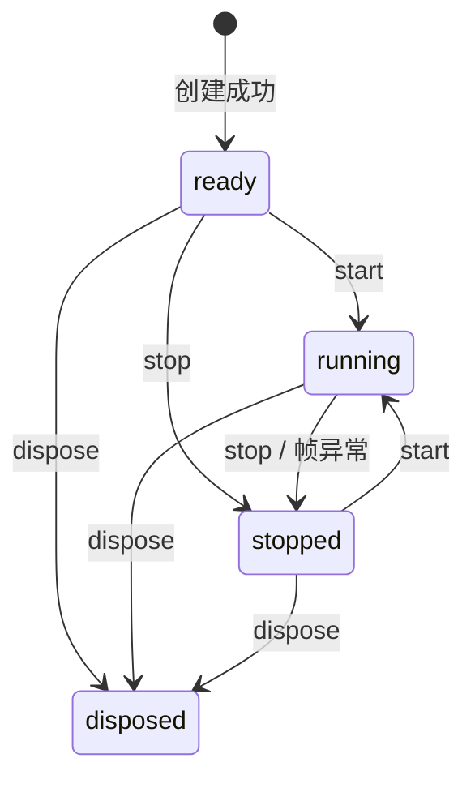

# 详细设计与实现契约

## 当前实现

核心位于 [packages/three](../packages/three/package.json)，提供 `ThreeApp`、`OrthographicThreeApp`、`ResourceScope` 和类型；可选 controls、loaders、interaction、labels、animation、camera、postprocessing、environment、textures、capture、geometry 分别提供控制器/变换、模型加载、拾取、DOM 标签、动画/定位、取景、泛光/描边、HDR 环境、独立图片纹理、画布截图和实例化网格。website 使用工作区公开入口。未引用的初始化模板包和素材已删除；现有工程模板、Skills 与文档校验继续使用。

核心决策见 [ADR-0002](adr/0002-core-mvp.md)，模型阶段见 [ADR-0003](adr/0003-gltf-lifecycle.md)，动画扩展见 [ADR-0004](adr/0004-animation-lifecycle.md)。完整选项、默认值和示例以 [主包 README](../packages/three/README.md) 与导出类型为准；已通过可选泛光模块接入自有 composer；尚无寻路、框架适配或 WebGPU 实现。

## 核心 API

renderer 配置在 DOM/GPU 分配前快照。类型 Omit 不阻止更宽的原生参数变量，运行时同样拒绝非空 canvas/context，null/undefined 字段丢弃且不修改原对象；renderer 本身不能是 null、数组或非对象。其他 getter 各读取一次，其后输入改写不进入 native 构造。两类宿主均只拥有自己创建的 canvas/WebGL 上下文；见 ADR-0002 的补充。

新增 RenderPipeline 类型：render(FrameInfo):void、resize(ViewportSize):void；setRenderPipeline 借用对象并返回幂等解除函数。挂接时通知当前尺寸，后续在变化或失败待重试时通知，包括零尺寸/暂停/DPR；旧解除函数不影响新租约。重复挂接拒绝，初始化错误或同步销毁释放槽位。宿主销毁解除引用而不调用借用对象 dispose，所有者自行登记资源。

render():boolean 显式绘制一帧，沿用当前管线或原生 renderer，并派发 onAfterRender；不触发 onUpdate、不调度 RAF、不推进 elapsed，delta=0。ready/stopped/running 可用，隐藏/零尺寸跳过返回 false，disposed 后拒绝。同步调用 renderer/pipeline 并正常返回后为 true；准备中断/租约失效导致未调用时为 false。已绘制后观察者改变运行状态仍为 true，不表示 GPU 完成或第三方管线输出正确。更新/绘制/完成阶段和尺寸处理期间重入拒绝；异常停止宿主后抛出。自动帧和手动绘制共享绘制阶段及完成订阅竞争规则，生命周期变化中止剩余完成回调。详见 [ADR-0009](adr/0009-render-pipeline.md)。

| 公开接口                                                | 具体职责与契约                                                                |
| ------------------------------------------------------- | ----------------------------------------------------------------------------- |
| `new ThreeApp(container, options?)`                     | 浏览器容器必需，创建自有 scene/camera/renderer/canvas，参数先校验，不自动启动 |
| `scene/camera/renderer`                                 | 原生对象的只读引用；不支持替换对象或额外并行渲染循环                          |
| `start()/stop()`                                        | 幂等启停；销毁后 start 抛错、stop 无操作                                      |
| `onUpdate((frame: FrameInfo) => void)`                  | 返回取消函数；按注册顺序同步执行；同一函数可多次独立订阅                      |
| `onAfterRender((frame: FrameInfo) => void)`             | 全部更新与成功渲染后执行，适合 DOM 投影；不依赖与更新回调的注册先后           |
| `resize()` / `size`                                     | 从容器 clientWidth/clientHeight 与 DPR 获取尺寸；size 返回快照                |
| `resources.track<T extends Disposable>(resource: T): T` | 显式接管，scope 内按引用去重，不遍历 scene                                    |
| `resources.untrack(resource): boolean`                  | 归还所有权，不 dispose                                                        |
| `dispose()` / `signal`                                  | 幂等结束生命周期；signal 同步 abort；清理失败最终抛 AggregateError            |
| `attachOrbitControls(app)`                              | controls 独立入口，返回原生 controls 与 dispose，随宿主统一更新和释放         |

默认 fov=50、near=0.1、far=1000、position=[3,2,5] 并看向原点，maxPixelRatio=2、maxDelta=0.1 秒；renderer 默认 antialias=true，配置不接受外部 canvas/context。范围数值必须正且有限，fov<180、far>near，位置为三个有限数值。

## 正交宿主契约

OrthographicThreeApp 采用独立 options.camera（frustumHeight=10、near=0、far=1000、position=[0,0,10]），原生 camera 精确类型为 OrthographicCamera，ThreeApp 仍为 PerspectiveCamera。内部泛型 SceneHost 复用所有生命周期/绘制/资源/监听；AnyThreeApp 为可选模块公共借用类型，无额外运行时基类导出或新循环。正交配置及可表示投影在 GPU 分配前验证。

非零尺寸变化保留当前 top/bottom、水平中心和 zoom，按 CSS 比例写 left/right 并更新投影；DPR 仅改缓冲，零尺寸保留有效视锥，失败保留待重试尺寸。原生字段修改仍由消费者 updateProjectionMatrix，view offset 借用。相机无关模块接受 AnyThreeApp；正交自动取景为独立函数，既有透视取景/过渡保持原类型。具体宿主约束见 [ADR-0026](adr/0026-orthographic-host.md)。

## 正交取景契约

透视 fitObject 的相机写锁也覆盖选项 getter 与世界边界/顶点准备，准备期间同相机的即时/平滑取景拒绝。失败不取消原有效过渡，不留写锁；控件标志仅在实际租用后恢复，恢复异常仍释放锁。纯 computeObjectFrame 不接管相机写锁。

computeOrthographicFrame(OrthographicCamera,Object3D,ObjectFrameOptions?) 返回 OrthographicObjectFrame，包含 ObjectFrame 全字段与 zoom；fitOrthographicObject(OrthographicThreeApp,Object3D,FitObjectOptions?) 应用计划，无绘制/启动/订阅。未缩放视锥保持，zoom 根据两轴最小跨度、世界 AABB 包围球与 padding 计算，距离及裁剪面保守容纳深度。边界准备与透视共享，包含子树外骨骼及更新绑定逆矩阵。

仅接受居中、无父级/缩放、自动矩阵且无 view offset 的相机，拒绝不可表示/空/退化边界。校验控件归属、zoom/distance/target 约束；保留约束并临时关闭/恢复 damping 与 autoRotate。adjustClipping=false 允许 near=0，但不足的原裁剪面拒绝。准备期起持有相机写锁，getter/顶点/控件异常也释放；不回滚原生副作用，不自动跟踪尺寸或目标。详见 [ADR-0027](adr/0027-orthographic-framing.md)。

## 正交过渡契约

transitionOrthographicToObject(OrthographicThreeApp,Object3D,CameraTransitionOptions?) 返回 CameraTransitionHandle<OrthographicObjectFrame>；句柄/结果新增默认 ObjectFrame 的泛型参数，不改既有透视调用。复用内部执行器的宿主 delta、smoothstep 姿态/轨道和输入租约；正交额外对 zoom 作凸组合并更新投影，near=0 可作为起始/保留裁剪面。

准备/应用持有写锁；外部视锥/zoom 或 min/maxZoom 改写在有效更新取消，暂停/零尺寸不轮询，目标不自动跟踪。scope/signal/替换/即时应用与错误清理沿用既有过渡。即时正交 fit 在取消旧过渡之后保存恢复配置。默认先扩裁剪再收紧，取消保留当前状态。见 [ADR-0028](adr/0028-orthographic-transition.md)。

## 相机视图契约

camera 和 animation 共同导出 TransitionEasing="linear"|"smoothstep"。取景/书签过渡及 CrossFadeOptions.easing 在准备时捕获预设，分别默认 smoothstep/linear；progress/blendProgress 仍是原始时间比例。相机因子用于姿态/镜头，渐变因子仅用于当前有效权重交接；无逐帧用户回调，不保证世界/屏幕匀速。非法值在替换前拒绝，书签准备后重查取消，见 [ADR-0039](adr/0039-transition-easing.md)。

CameraTransitionState 新增 paused，两种过渡句柄 pause()/resume() 只冻结自身进度，不影响宿主或其他目标。暂停保留输入/资源/相机租约，下一宿主更新仍检查外部修改；取消、signal、scope、替换照常结算。继续仅消费后续 delta。初始化/原生写入回调中的控制请求延后到本次提交结束，终点/异常优先；终态调用无操作，见 [ADR-0037](adr/0037-camera-pause.md)。

captureCameraView(AnyThreeApp,CameraViewOptions?) 返回 CameraView，restoreCameraView(app,view,options?) 返回实际恢复后的新快照。version=1，kind 为 perspective/orthographic，公共字段 position/quaternion/up/zoom/near/far，可选 target；透视有 fov，正交有 top/bottom/centerX。数值数组独立，可由消费者 JSON 往返和跨同类宿主使用，无原生对象或资产引用。

恢复按当前 CSS 比例重算 aspect/水平范围，保留垂直构图。拒绝父级/缩放/手动矩阵、view/filmOffset、坏元组/非有限/未归一化四元数、无效裁剪及不可表示候选。capture 零尺寸可用且不取消运动；restore 需有效视口，准备起持写锁，验证后才取消旧过渡。不自动绘制、启动、持久化或接管资源。

借用 controls 时保存 target，要求无 roll/单位 up；恢复要求同相机、当前 up 一致及已有 target，校验距离/正交 zoom/目标范围，原生角度限制仍可调整实际姿态。先取消旧租约再暂存配置，通过公开 update 清惯性并同步，finally 恢复 damping/autoRotate 与写锁；错误不回滚原生副作用。详见 [ADR-0029](adr/0029-camera-views.md)。

transitionToCameraView(app:AnyThreeApp,view:CameraView,options?:CameraViewTransitionOptions):CameraViewTransitionHandle 平滑恢复同类书签。options 含 controls、正有限 duration（默认 0.8 秒）、signal；句柄 state/progress/finished/cancel/dispose，完成结果携带实际 view，取消/失败结果分别携带 status/error。源/终点复制验证后才替换旧租约；当前 CSS 比例规划终点，不自动绘制或启动。

仅复用宿主更新，smoothstep 位置/四元数/zoom/镜头插值；带控件时插值 target、单位球面方向和正距离，原生 update 可按角度约束调整姿态。开始扩 near/far、完成收紧，取消保留当前状态；无控件 up 仅在结束恢复。准备/应用写锁和每相机唯一登记与取景共用；输入、所有者、尺寸、姿态、投影和约束变化结束租约，控件标志按值恢复。原生副作用不回滚，清理失败独立聚合。详见 [ADR-0035](adr/0035-camera-view-transition.md)。

## EXR 环境契约

environment 新增 loadEXR(AnyThreeApp,url,LoadHDROptions?):Promise<HDREnvironment>，复用既有资产/绑定与清理；loadHDR 继续为 RGBE，EXR 固定原生 part=0、HalfFloat RGBA，保留原生色彩空间/flipY/过滤并设置环境映射。显式 URL/格式，不自动曝光或绑定。

共用内部加载任务，不 abort FileLoader 合并运输；EXR 有效响应在同步解析前复制 ArrayBuffer，解压不污染其他任务，结束响应跳过解析。解析期间结束则释放迟到纹理，不能抢占同步解压，取消后错误沿用 onCleanupError。原绑定先解绑再释放源与原生转换缓存；见 [ADR-0030](adr/0030-exr-environment.md)。本轮仅以原创单 part 未压缩 RGB 样例验收，不声称全部 EXR 编码矩阵通过。

## 模块与关键流程

| 模块     | 实现                                                 | 关键边界                                           |
| -------- | ---------------------------------------------------- | -------------------------------------------------- |
| 宿主     | [three-app.ts](../packages/three/src/three-app.ts)   | 实例状态、平台监听、统一 render、构造失败回滚      |
| 帧调度   | [frame-loop.ts](../packages/three/src/frame-loop.ts) | 单 RAF、epoch 失效、delta 计时与限幅、回调内重启   |
| 资源归属 | [resources.ts](../packages/three/src/resources.ts)   | 显式登记、逆序去重、聚合异常、清理前先终止 scope   |
| 控制器   | [controls.ts](../packages/three/src/controls.ts)     | 可选依赖，不创建额外循环，手动移除与宿主释放不重复 |

创建过程：校验容器/配置/ResizeObserver → 创建 scene/camera/renderer → 挂 canvas → 绑定 observer、窗口 resize、文档 visibility 和 DPR 媒体查询 → 初始 resize。后续步骤失败则调用 dispose 回滚；回滚异常与原错误聚合。

帧过程：检查 epoch → 计算 delta 和 elapsed → 拍摄更新订阅快照 → 逐个同步 update → 状态/代次仍有效时 render → 拍摄渲染完成订阅快照并逐个调用 → 若仍属当前运行代次安排下一帧。各阶段内新增订阅下一帧开始，取消订阅在当前帧生效；在 update 中新增的 onAfterRender 可于本帧执行。任一回调、render 中 stop/dispose/重启均使旧帧剩余阶段失效；任一阶段同步异常先 stop，再重新抛给浏览器。直接调用原生 renderer.render 不触发宿主订阅。

running 是用户运行意图；文档隐藏或容器零尺寸时暂停 RAF 但仍为 running，恢复自动调度。每次恢复首帧 delta=0；elapsed 累计有效帧中经 maxDelta 限幅的秒数，暂停期间不计入。宽高或 DPR 变化时才 setDrawingBufferSize 和更新投影；无效尺寸保留之前的合法投影，避免除零。DPR 由 matchMedia 变化和窗口 resize 检测，媒体监听变化时重新绑定。

## 释放与边界

销毁顺序：标记 disposed → 停止帧与 abort signal → 清更新和渲染完成订阅 → 撤 observer/平台监听 → 逆序释放显式资源 → scene.clear（只 detach）→ renderer.dispose → forceContextLoss → 移除自有 canvas。各步骤异常不影响后续步骤，最终 AggregateError；重复 dispose 不重试失败项。

资源 scope 内按对象引用去重；借入或跨实例共享资源留给外部所有者，不由某个实例独占登记。登记 Mesh 不自动接管其 geometry/material/texture。textures 需单独登记；材质释放不隐含纹理释放。scope 销毁后 track 抛错，untrack 只解除登记。异步业务应检查 signal 并自行清理迟到结果；模型加载另见下节契约。

容器尺寸基于 clientWidth/clientHeight，建议无 padding，CSS transform 不改变绘制分辨率。构造仅限现代浏览器，要求 WebGL 2 / ResizeObserver / matchMedia；模块导入不访问 DOM。没有数据库、事务、后端鉴权或隐式遥测；资产权限由应用负责。

管线方法 getter 属于可重入边界：挂接时各读一次并重新确认宿主和独占槽位，首次尺寸通知使用该快照；每次后续通知/绘制读取当前方法后检查宿主及原租约。失效则跳过旧方法，未绘制不派发完成通知；调用保留管线对象 this，不冻结之后的方法替换或回滚 getter 副作用，见 ADR-0009。

## 画布截图契约

截图检查 render 的布尔结果；false 时在分配临时画布前拒绝并清理 pending/监听，不导出旧缓冲。保留取消和可用性错误优先级，宿主仍可重试，见 ADR-0021。

CaptureFrameOptions.region 可选，类型 CaptureRegion 包含只读 x/y/width/height；左上角起算的 drawing-buffer 像素，x/y 非负安全整数，宽高正安全整数。四个数值先快照；范围在 app.render 后以最终实际 canvas 宽高校验，越界拒绝且不分配临时画布，贴边有效。九参数 drawImage 复制到同尺寸原点，不重采样、不换算 CSS/DPR 或隐式裁边。默认完整截图和取消/编码清理不变，见 [ADR-0031](adr/0031-capture-region.md)。

capture 独立入口提供 captureFrame(app, CaptureFrameOptions):Promise<Blob>。type 默认 PNG，可选 JPEG/WebP；quality 可选有限 [0,1]，signal 可选。校验可绘制状态与默认 render target，复用 app.render 后同步复制当前 drawing buffer 到 detached Canvas 2D，再 toBlob；不推进动画、改变运行意图/相机/管线或增加 RAF。像素与后续帧/尺寸隔离，不包含 DOM/CSS 界面，不是 HDR/任意分辨率导出。

pending 编码登记宿主 scope 并监听两个 signal，逻辑取消立即拒绝 AbortError，迟到结果丢弃；所有结束路径解除登记/监听、归零画布，清理错误继续并聚合。原生 null/编码/CORS、隐藏/零尺寸/丢失上下文/非默认目标或宿主绘制重入失败正常拒绝。浏览器格式可回退 PNG，以实际 Blob.type 为准；Blob URL/下载属于应用，详见 [ADR-0021](adr/0021-frame-capture.md)。

## 上下文丢失契约

ThreeApp.contextLost 为只读黏性诊断，初始 false；自有 canvas 收到 webglcontextlost 后先设 true，再完整 dispose，普通主动销毁不改变该标记。已丢失时不重复 forceContextLoss；既有 abort、RAF/订阅失效、scope 清理和错误聚合全部执行。旧 canvas 的迟到恢复不能复活宿主，应用通过 signal.abort/contextLost 判断并显式创建新 ThreeApp；不替换公开 renderer、不自动重载或重试。

当前 r187 软件 WebGL 原型的自动恢复在旧 GPU 清理时出现 1282，故不承诺保留运行意图自动继续。自有资源在丢失期间清理旧缓存和监听；借用的管线仍需调用者登记其自有清理。另一宿主的模型实例通过共享租约继续存活；pending 模型仍遵循逻辑取消与迟到清理。完整依据与验证边界见 [ADR-0019](adr/0019-context-loss.md)。

## GLTF / GLB 异步契约

[loaders.ts](../packages/three/src/loaders.ts) 为独立公开子入口，导出 `loadGLTF(app, url, options?): Promise<GLTFModel>`、LoadGLTFOptions、GLTFModel、ModelProgress。返回原生 scene/gltf、disposed 和 dispose；默认挂载，可 addToScene=false，保留原始材质、尺寸与坐标，不启动 Mixer。

模型另有只读 resources 扩展 ResourceScope：模型 dispose 标记结束后先调用它，再 detach、清局部节点/骨骼并释放共享资产租约；扩展失败仍继续清理，聚合错误。单独释放扩展 scope 不等于移除模型，也不影响已拍摄快照的归属。动画登记于此，loader 不导入动画实现。

流程：校验 URL 与预取消状态 → 创建独立 manager/loader → 登记 pending 清理句柄与取消监听 → 原生 loadAsync → [资源快照](../packages/three/src/gltf-resources.ts) → 若已终止则释放迟到模型 → 登记模型句柄 → 可选加入场景 → 再次检查宿主是否被同步挂载事件销毁 → 清监听和 pending → resolve。普通失败保持原始错误；signal、宿主或 scope 结束立即 reject AbortError。

不调用 manager.abort：r187 FileLoader 按 URL 全局合并请求，运输中止可能连带其他任务。取消是逻辑取消；底层网络/解码可继续，但迟到成功会释放而不挂载，迟到失败有拒绝处理器。完成后 signal 不再影响模型；app.resources 接管模型，手动或宿主释放均幂等。

资源在交给调用方之前拍摄快照，遍历全部返回 scenes，收集自有节点、geometry、material、texture、skeleton 并去重。之后加入的外部子对象/新材质不被接管。纹理释放后才 close 自有图像 backing；加载开始/完成或释放时 Cache 启用则保留图像，外部共享者可设 closeImageBitmaps=false；不更改全局 Cache，调用方不要在任务期间反复切换它。cloneGLTF 创建的实例由下述租约协调，绕过它的原生克隆仍需外部协调生命周期。

onProgress 仅代表主文件 bytes；total/ratio 在未知时为 null，不把下载 100% 等同全部依赖/解码完成。回调异常仅拒绝该任务，避免抛入合并请求的进度循环。晚到清理错误通过 onCleanupError 报告，未设置时 console.error；清理仍尝试所有资源。原生解析失败而未返回的局部资源不在快照内，不宣称完整回收；当前不注入通用 loader/插件，不创建共享模型缓存。

## 模型实例契约

loaders 另导出 cloneGLTF(app,source,options):GLTFInstance、CloneGLTFOptions、GLTFInstance。source 为本库仍存活的 GLTFModel/GLTFInstance，默认 addToScene=true；false 仍由目标宿主拥有。同步复制当前默认 scene，返回 scene、独立 animations、扩展 resources、disposed/dispose，不复制 GLTF parser、其他 scenes、外部监听或扩展 scope。

使用原生 SkeletonUtils.clone，拒绝树外骨骼，独立 inverse 矩阵和实例 morph 数据；片段/轨道数据复制，UUID 节点绑定改写，命名路径沿用原生规则。attachGLTFAnimations 接收两种句柄，仍只订阅目标宿主并双范围清理，不自动播放/绘制/启动。节点/骨骼数值独立，共享材质属性动画不承诺独立，自定义 clone/插件兼容性待验证。

原加载快照拆成局部节点/骨骼 scope 与共享资产 scope；内部弱引用登记只接受真实句柄，无 URL 缓存。原模型/实例各持幂等租约：先清各自扩展和节点，再释放租约，最后一个使用者释放整份原始 geometry/material/texture/image 快照（包括其他原始 scenes 的资产）。源结束不影响存活实例；原句柄不能再克隆，存活实例可继续克隆。借用的后加资源仍由外部管理；共享资产不可提前手动释放，修改仍影响其他使用者。

克隆前和原生操作后检查所有者，挂载时同步失效则回滚自有节点、骨骼、登记和租约；失败继续清理并聚合，不回滚原生自定义副作用。详细取舍见 [ADR-0018](adr/0018-gltf-instances.md)。

## 压缩解码契约

loadGLTF 增加 draco:DracoOptions 和 meshoptDecoder。Draco 显式提供以 / 结尾的非空目录或 r187 的 `{js,wasm}` URL 对，workerLimit 默认 1 且须为正整数；URL 字段在异步开始前拍快照。空/无效配置在请求前拒绝；Meshopt 类型沿用原生 setMeshoptDecoder，保持借用且不改其 Workers。

每任务独立 DRACOLoader，配置后交给该任务 GLTFLoader，不预加载；普通调用不创建它。逻辑取消和宿主销毁只结束外部 Promise，原生加载仍可完成；原生成功或失败的 continuation 最后释放任务解码器，取消不提前终止 Worker，迟到模型仍清理。设置中失败/取消且尚未开始请求则立即回滚。解码器 dispose 失败通过 onCleanupError 报告，不撤销模型或覆盖原错误；Reporter 失败沿用兜底日志。

独立实例有重复初始化成本，后续真实并发场景再设计共享服务，见 [ADR-0005](adr/0005-compressed-models.md)。主包不分发二进制、不默认 CDN、不使用废弃的纯 JS 类型配置；演示通过 Vite URL 导入本地 Draco 文件、按需导入 Meshopt。开发编码器固定 draco3dgltf 1.5.7 / meshoptimizer 0.25.0，只生成原创几何，许可见 [记录](../apps/website/public/licenses/README.md)。一般资产优化留后续。

## KTX2 模型契约

loadGLTF 的 ktx2:KTX2Options 接受显式 transcoderPath（以 / 结尾的非空目录，或 `{js,wasm}` URL 对）及 workerLimit（默认 1，整数 1–32）。配置拍快照并在分配前校验；任务内部 [TaskKTX2Loader](../packages/three/src/ktx2-task.ts) 经 detectSupport(app.renderer) 初始化能力，借用 renderer，不提前加载 WASM。URL 对在私有 LoadingManager 中只映射原生两个转码文件，模型纹理 URL 保持原样。

parse 前复制 ArrayBuffer，隔离 FileLoader 合并请求/缓存与原生全局 task cache，保证独立模型不共享 Texture；不修改 Cache。适配层计数已开始的解析，原生模型完成时关闭新解析，现有解析全部结束才释放 Worker/Blob URL。逻辑取消只结束外部 Promise；迟到成功仍由模型快照清理。原生模型失败且仍有解析时继续等待回调，对未移交的 KTX2 纹理逐项释放；释放错误经 onCleanupError 报告，不阻断其他解码器清理。

modelHandle 的资源快照建立后才移交已创建纹理，随模型/宿主释放。记录首个 KTX2 文件/解析错误，避免 GLTFLoader 吞掉纹理错误而交付缺贴图结果；若原生返回了部分模型，先建立并清理快照再拒绝原错误。其他 PNG/JPEG 的错误行为沿用原生实现。r187 未 init 的 KTX2 实例不调用原生 dispose，以保护原生活动计数；已 init 的实例在所有解析结束后恰好释放一次。版本相关细节与代价见 [ADR-0006](adr/0006-ktx2-lifecycle.md)。

实测范围为模型中的 ETC1S/BasisLZ、压缩上传和禁用压缩扩展时的 RGBA 回退；无独立纹理入口、不强制某一 GPU 压缩格式。原创 checker.ktx2 具有 16×16 像素和 5 级 mip，ktx2.gltf 使用外部纹理便于验证 URL 合并，ktx2.glb 内嵌同一内容。固定哈希的官方 Basis 开发编码工具缓存于忽略目录，首次生成需网络，运行时资源仍来自锁定 Three.js。原生请求/Worker 永不完成和未返回的其他局部资源仍有边界，不承诺自动超时或长期无泄漏。

## 相机取景契约

蒙皮目标在 precise 顶点采样前，先刷新其引用骨骼的世界矩阵（可位于目标子树外），再调用 SkinnedMesh.updateMatrixWorld 按原生 bindMode 刷新绑定逆矩阵。支持暂停后的骨骼和父级变换；不推进 Mixer、不修改骨骼 inverse-bind 数组或分配 boneTexture。computeObjectFrame 的结果仍是调用时快照，不接管逐帧剔除边界或自定义 shader 位移。

[camera.ts](../packages/three/src/camera.ts) 为独立入口，导出 computeObjectFrame、fitObject、ObjectFrameOptions、FitObjectOptions、ObjectFrame。computeObjectFrame 接收透视相机与借用对象，更新世界矩阵后以 Box3.setFromObject(true) 得到 AABB；取对角线一半为半径，结合 zoom 的有效双轴半视角与 padding 计算距离，minimumDistance 作下限。推荐 near=(distance-radius)/2、far=distance+2*radius，检查数值范围；返回向量/边界快照，不移动相机。

fitObject 在宿主/scope 存活和非零视口时即时应用；默认 adjustClipping=true，false 时先验证当前裁剪范围可容纳目标。可借用当前相机的 OrbitControls，合并 minDistance，检查 maxDistance、cursor/目标半径与有效角度配置；不可容纳时先拒绝。原生角度限制可改变方向，保守球仍用于取景。临时关闭 damping/autoRotate，经公开 update(0) 清惯性后写 position/target，再更新投影、控件和世界矩阵；finally 恢复设置。WeakSet 仅防同相机同步重入，无长期订阅或资源持有；同步事件中检查宿主存活，错误不承诺回滚消费者副作用。

只支持未挂父节点、无缩放、自动矩阵、居中视锥的透视相机。空/退化/非有限边界和参数拒绝，目标不要求挂入本场景，函数不接管或变换它。无 RAF/render/自动启动，不自动跟随动画或 resize；暂停时演示显式绘制一次并更新标签。详细默认值与限制见主包 README、[ADR-0007](adr/0007-camera-framing.md)。

## 模型动画契约

GLTFAnimationsHandle.playbackRate 反映原生 mixer.timeScale，初始 1；setPlaybackRate(rate:number):void 接受非负有限数，0 冻结模型时钟而不改变状态。对全部贡献动作及渐变生效，动作级 timeScale 仍相乘；保留姿态、片段/循环时间和权重，不采样/绘制/启动。跨 pause/resume/seek/stop/play 保留，新控制器默认 1。参数调用时校验，通知/原生事件内命令排队，异常或销毁丢弃未执行设置；详见 [ADR-0036](adr/0036-animation-playback-rate.md)。

GLTFAnimationsHandle.on<K extends keyof GLTFAnimationEvents>(type,callback) 返回解除函数，loop payload 为 type/action/clip/loopDelta，finished 为 type/action/clip/direction；公共 union 为 GLTFAnimationEvent。当前选中动作采样、端点归一化及权重交接后派发，尚未绘制 GPU。渐变目标提前结束时延后 finished，忽略离场动作；loopDelta 沿用原生合并通知。通知期间控制方法继续排队，批次结束再执行；订阅快照支持独立重复、增删与销毁，异常终止批次并丢弃未执行命令。无历史回放，不因 stop/seek/pause 合成完成，不等待异步回调；见 [ADR-0025](adr/0025-animation-notifications.md)。

[animation.ts](../packages/three/src/animation.ts) 导出 attachGLTFAnimations、GLTFAnimationsHandle、PlayAnimationOptions、CrossFadeOptions、AnimationState。接收已加载模型或实例，片段引用拍只读数组快照；一个根对象只允许一个活动句柄，同时登记宿主和模型 scopes，任一结束都取消更新并清理自有 Mixer，不释放借用资产。

初始 idle，无自动播放/宿主启动。play 接受合法索引或唯一精确名称，校验正有限 duration、原生 clip.validate、repeat/once/pingpong 和正有限速度后才替换旧 action；立即采样零时刻。切换或重播停止旧 action，reset 当前片段，设置 weight/timeScale/loop/clamp 并 play。暂停跳过采样但保留速率配置；resume 只恢复 paused；finished 不再推进，play 可重播。stop 停止 action、恢复原生绑定属性并清空选择和时间。销毁后控制方法抛错，stop/dispose 幂等。

repetitions 为正安全整数或 Infinity，repeat/pingpong 默认 Infinity，once 默认且只接受 1。每次单向遍历算一次，pingpong=2 次是一去一回。有限结束进入 finished；clamp=true 的往返按奇数终点、偶数起点固定。r187 原生最后一次采样存在奇偶错位，finished 仅登记，待原生 update 返回后通过公开 reset/time/paused 归一端点，再零 delta 采样；同时覆盖离场动作，不增加 Mixer 时间。事件中销毁则跳过归一并延后释放，事件内控制仍按队列执行。seek 重置循环历史到首个正向片段阶段，保留次数/模式；复用仍在播放的渐变目标继续既有原生循环进度，不把 repetitions 当剩余次数。详见 [ADR-0023](adr/0023-animation-loops.md)。

正常由 onUpdate(delta) 采样，复用宿主的隐藏/零尺寸暂停与 delta 限幅。原生事件内的控制命令暂存到本次 update 结束后依序执行；销毁立即失效并清空命令，但 stopAllAction/uncacheRoot 延后至调用栈返回，避免修改正在遍历的缓存。普通模型销毁先结束 Mixer 再清 GPU；原生事件中销毁模型时，GPU 资源可先清理，CPU 最后一次采样后再释放缓存，不重新挂载。更新/清理错误交给宿主，详细边界见 ADR-0004。

提供下述普通权重渐变切换，不提供反向、任意混合图、状态机或重定向。原生 mixer/action 由调用方查询、配置参数，但不能再手动驱动或维护缓存；原生事件监听和 CPU 引用由业务解除。演示用独立原创 animated.glb 的 Lift/Slide，不修改原静态 fixtures；关闭动画模型的手写旋转以避免重复驱动。

seek(seconds) 新增于 FR-027：选中片段后接受 [0,duration] 有限秒数，reset 原生动作的循环/完成状态，写入 action.time 并 sample(0)，定位后 paused。保留 loop/clamp/weight/timeScale，mixer.time 不前进；不主动绘制或启停。完成动作也可定位，精确端点在暂停时保持，恢复依原循环规则处理。原生事件内先校验、后排队，执行前按实际选择再次校验，队列中更早的 play/stop 不会使非法时间写入。复用延期清理，见 [ADR-0015](adr/0015-animation-seek.md)。

crossFadeTo(selector,CrossFadeOptions) 扩展动画控制，duration 默认 0.3 且正有限，其他选项同 play。公开 blending/blendProgress；从当前有效权重快照按 Mixer 缩放秒线性渐变，已有目标 action 保留时间，同目标无操作；无旧动作时正常播放。普通 blend mode 与有效 [0,1] 权重，Mixer timeScale 非负有限。中断重拍当前权重，结束在 native update 返回后 stop 旧动作，最多每片段一个 action。pause/宿主暂停同时冻结；一次播放先结束时继续渐变直到完成后置 finished。play/stop 取消所有渐变；seek 停旧动作并全权重定位当前目标（无渐变时仍保留权重）。复用事件排队/延期清理，详见 [ADR-0017](adr/0017-animation-crossfade.md)。

## 相机过渡契约

camera 入口另导出 transitionToObject、CameraTransitionOptions/Handle/State/Result。内部 camera-frame 复用规划校验，camera-runtime 用弱引用登记同相机过渡和同步写入锁，camera-transition 管理插值及清理。即时 fitObject 验证成功后也会取消同相机过渡。

options 扩展 FitObjectOptions，duration 默认 0.8 秒且必须正有限，signal 可选。句柄 state 为 running/completed/cancelled/failed，progress 为未经缓动的 0..1；finished 始终 resolve 对应结果，completed 含 frame，failed 含 error。cancel/dispose 幂等且保留当前位置。非法参数同步抛错，不打断有效旧请求；已 abort 的 signal 返回 cancelled 句柄。

只订阅宿主 onUpdate，以有效 delta 累积进度并应用 smoothstep，不主动启动或 render。无控件插值 position/quaternion；有控件插值 target、距离、最短方向旋转，经原生 update(0) 应用角度限制。临时关闭 enabled/damping/autoRotate，结束仅恢复仍为 false 的配置；用户已改为 true 的值保留。adjustClipping=true 在开始扩展裁剪面，完成收紧；取消保留当前姿态及扩展范围。

句柄登记 app.resources；取消、signal、替换、即时取景和 scope/宿主销毁清理全部监听及订阅。有控件时捕获画布 pointerdown/wheel 取消，让同一手势交给恢复后的控件；外部视口/投影/姿态/控件配置变化于下一次有效更新取消。同步原生事件可取消或销毁，同相机重入取景拒绝。更新异常清理、resolve failed 后重新抛给宿主；清理失败聚合到结果且继续清理。

沿用即时取景的相机/边界限制，不跟踪对象和目标删除，不接管模型。演示在模型移除/缩放时主动取消。暂停、隐藏、零尺寸保留进度，不补墙钟时间；没有独立暂停 API。路径不避障、不保证中途目标完整可见，细节见 [ADR-0008](adr/0008-camera-transition.md)。

## 泛光契约

可选 postprocessing 入口提供 attachBloom(app, options?)，返回 BloomHandle（pass:UnrealBloomPass、disposed、幂等 dispose），选项 BloomOptions（strength=1、radius=0.4、threshold=0.85、enabled=true）。初始强度/阈值为非负有限数，radius 位于 [0,1]，enabled 为 boolean。原生 pass 可调整参数和 enabled，不再对直接属性写入做包装校验；不手动销毁 pass 或改写管线。

内部固定 RenderPass → UnrealBloomPass → OutputPass，使用自有 HalfFloat 目标和独占 RenderPipeline。模块 scope 拥有 composer 与 passes，句柄登记 app.resources，任意挂接失败逆序清理；不改写 renderer.render 或 tone mapping，不创建 RAF/observer。disabled 仅旁路 bloom，保留目标与基础/输出 pass；dispose 解除租约并释放资源，默认绘制恢复。

resize 去重并同步 CSS 尺寸与 DPR，零尺寸保留上次目标；单次 app.render 也经过效果链。渲染期 dispose 立即失效并禁用后续 passes，当前原生执行返回后清理 GPU 资源；错误继续清理并聚合。保存并恢复借用 renderer 的 target、autoClear、toneMapping、清屏色和 alpha，宿主结束则不再写原生对象。详见 [ADR-0010](adr/0010-bloom-lifecycle.md)。

## 组合效果与选择描边契约

正交演示消费同一 attachPostprocessing 入口和独占管线，使用 ACES 映射，选择由拾取写原生 selectedObjects；enabled 旁路保留资源，组合开关释放整条链。真实正交像素与三次纹理/framebuffer 回到预热基线已专项验证，不据此声称所有可选模块/设备的正交组合均已验收。

attachPostprocessing(app, PostprocessingOptions) 至少提供 bloom 或 outline；PostprocessingHandle 提供可选原生 bloom/outline、disposed、dispose。attachBloom 是兼容包装，委托同一模块。固定顺序为基础 RenderPass、可选 OutlinePass、可选 UnrealBloomPass、末尾 OutputPass；不做任意编排或独立句柄隐式合并。

OutlineOptions：selectedObjects=[]（借用对象数组快照）、edgeStrength=3、edgeThickness=1（范围 [1,4]）、edgeGlow=0、enabled=true；强度/光晕非负有限。visibleEdgeColor/hiddenEdgeColor 可选 0..0xffffff 整数，否则原生默认。对象必须为 Object3D；直接更新原生参数由应用保证有效。消费者负责与拾取/模型生命周期同步，dispose 清空选择，不释放模型资产。

描边启用且有选择时保存 scene.background/overrideMaterial 和场景/选择对象的 visible 快照，仅绘制失败恢复。resize/render 不允许操作中重入，操作内销毁等原生调用返回再清理。失败尺寸保留 dirty 状态，同尺寸通知及下次绘制前可以重试，模块仅在原生设置成功后记录尺寸快照。其余尺寸、DPR、借用 renderer 状态、独占租约与资源契约保持，细节见 [ADR-0011](adr/0011-effect-composition.md)。

尺寸恢复补充：原生投影/绘制缓冲与管线分别保存待同步状态，失败停止调度且同尺寸重试，draw 前先完成原生缓冲、再管线通知。零尺寸不分配也不遗忘 dirty；尺寸处理中（含挂接首次通知）拒绝递归 resize、render 或重挂接管线，错误返回后释放操作保护。见 ADR-0009。

## 对象变换契约

controls 入口的 attachTransformControls(app, TransformControlsOptions) 允许 object、orbitControls、mode=translate、space=world、size=1。模式为 translate/rotate/scale，空间 world/local，尺寸正有限；目标借用本场景后代，拒绝 scene/外部目标/自有 helper。原生 OrbitControls 须匹配宿主相机/画布。单宿主独占，返回原生 controls、helper、disposed、attach/detach 和幂等 dispose。

原生 helper 挂入 app.scene，初始 geometry/material 快照去重拥有；后加节点及模型借用。手柄登记 app.resources，手动/scope/宿主释放解除全部自有事件、捕获和 helper，公开 disconnect 并释放快照，失败聚合继续处理。连接失败和挂载事件内同步销毁回滚；touchAction 按值恢复外部状态。目标改变通过句柄，原生仅配置参数/监听，不单独管理其生命周期。

拖拽暂存同相机/画布的 OrbitControls enabled、enableDamping、autoRotate，置 false 并 update(0) 耗尽残余惯性，结束仅恢复仍为 false 的属性。正常 pointerup、即使原生输入已禁用、指针取消/失捕获/失焦及 detach/dispose 都结束租约。取消保留位置，无撤销；消费者避免与相机过渡/模型动画同时写同对象。库无渲染/更新订阅，暂停绘制由消费者根据原生 change 决定。详见 [ADR-0013](adr/0013-transform-controls.md)。

## HDR 环境契约

配置读取完成后再次检查宿主、资产/扩展 scope 和绑定独占状态；选项 getter 引发的同步销毁或嵌套绑定会使外层调用在场景写入前失败。getter 自身产生的副作用由调用者负责，不撤销有效嵌套绑定。

environment 可选入口提供 loadHDR、HDREnvironment、LoadHDROptions、EnvironmentProgress，以及 attachEnvironment、EnvironmentOptions、EnvironmentBinding。loadHDR 返回 Promise，非空 URL、signal 与宿主资源存活校验；options 支持 signal、onProgress 和 onCleanupError。原生 FileLoader 只下载 ArrayBuffer，活动任务通过 HDRLoader.createDataTexture 解析并设置反射映射。保留默认 HalfFloat/LinearSRGB，不改变 scene；同 URL 原生运输共享，解析结果独立，不中止运输。取消立即拒绝 AbortError，迟到数据跳过解码，解析中取消则清理结果。进度回调错误拒绝本任务，异步清理错误报告；详见 [ADR-0012](adr/0012-hdr-environment.md)。

资产拥有原生 DataTexture、前置 ResourceScope、disposed 和幂等 dispose；宿主登记资产，清理先解绑再纹理释放，错误继续处理。attachEnvironment 只接受本宿主活动资产，单宿主独占；background=false、intensity=1，强度非负有限。借用 scene 原值，按纹理身份恢复 environment/background，强度仍为写入值才恢复；不销毁前值、不覆盖可观察外部修改。解绑不销毁资产，双范围登记使资产和宿主清理都解除绑定。

r187 renderer 自动生成背景立方图/PMREM，并在源纹理 dispose 时清理对应目标；库不手工重复生成。共享生成器 scratch 留到 renderer.dispose，GPU 回归先预热。应用负责请求版本、目标选择和暂停绘制，无新增 RAF；只覆盖 Radiance 等距柱状 HDR，不提供跨宿主共享所有权。原生 texture 不单独 dispose，应用解除额外借用引用后再释放资产。

## 独立图片纹理契约

textures 入口的 loadTexture(app, url, LoadTextureOptions) 返回 TextureAsset。options 支持 signal、colorSpace=SRGBColorSpace（另支持 LinearSRGBColorSpace/NoColorSpace）、flipY=true、onProgress({loaded,total,ratio})、onCleanupError，未知总量为 null。配置快照和宿主 Window.createImageBitmap 能力在运输前校验；不修改场景/材质或增加调度。

FileLoader 只共享 ArrayBuffer，不中止运输；每任务从 Blob 单独解码。位图 premultiplyAlpha/colorSpaceConversion 均 none，imageOrientation 按初始 flipY 烘焙，Texture.flipY=false 并 needsUpdate；颜色意图通过 Texture.colorSpace 交给 renderer。取消立即拒绝 AbortError，迟到字节跳过解码，在途位图关闭；迟到失败被消费，清理错误报告。句柄登记宿主，resources 前置解除引用后清纹理/原始位图，全部尝试并聚合异常，后换 image 为借用。应用负责材质 needsUpdate 和额外借用引用；详见 [ADR-0014](adr/0014-image-textures.md)。

loadKTX2(app,url,LoadKTX2Options) 同样从 textures 导出，返回 KTX2TextureAsset（CompressedTexture、resources、disposed、dispose）。显式 transcoderPath 与 workerLimit=1（1–32），绑定宿主 signal/scope，先 detectSupport 当前 renderer，再下载原始字节。取消早于解析时跳过转码；已开始的原生 parse 等回调结束再释放 Worker/Blob URL。共享 TaskKTX2Loader 的输入复制隔离全局任务缓存，成功移交单一资产、失败或迟到由适配层清理。只接受二维 Basis 输出，原始未压缩/数组/立方图拒绝并清理；颜色空间/mip/方向沿用文件和原生实现，不提供 PNG 的 flipY 覆盖。详见 [ADR-0016](adr/0016-standalone-ktx2.md)。

## 对象拾取契约

触摸沿用原生 PointerEvent，不增加独立 touch 监听。Chromium 模拟触摸专项以可信输入验证画布 CSS 缩放/双实例、标签消费输入、多触点使待点击失效、pointercancel 和后续点按恢复；两指 OrbitControls 操作改变相机而不派发 click。验收仅限当前浏览器模拟环境，未承诺真机/笔输入/完整手势兼容。

[interaction.ts](../packages/three/src/interaction.ts) 是独立子入口，导出 attachPicking、PickingOptions、PickingEvent 和 PickingHandle。`attachPicking(app, { objects, recursive?, dragThreshold?, updateSkinnedBounds? })` 使用必填目标 getter；recursive=true、dragThreshold=4 CSS 像素。句柄提供原生 raycaster、disposed、pick(clientX, clientY)、on("click" | "hover", callback) 与 dispose。

蒙皮拾取补充：PickingOptions.updateSkinnedBounds 默认 true；同步目标后按 recursive 范围去重更新骨骼世界矩阵、原生 attached bind inverse、sphere 及已有 box，不新建 box。每次有效拾取有顶点/骨骼 CPU 成本，应用已维护可关闭；不等于每帧渲染剔除或 shader 位移维护。pick 的 getter/矩阵/边界/raycast 期间禁止重入，原生操作后检查失效，错误仍释放保护，见 [ADR-0020](adr/0020-skinned-picking.md)。

pick 每次读取目标快照，更新相机/目标世界矩阵，以画布矩形将 viewport CSS 坐标映射至 NDC；不使用 drawing buffer 尺寸或全局容器。零尺寸/越界/非有限坐标返回 null；最近交点保留原生实际子对象，过滤 visible=false 的节点/祖先。支持偏移、滚动、轴向缩放，不支持 CSS 旋转/倾斜；其余沿用原生 CPU raycast，不保证 GPU 像素级一致或把非目标作为遮挡物。

click：主指针左键/单指 pointerdown 记录位置与命中对象 → move/up 任意位移超过阈值取消 → pointerup 同一 pointerId、同一对象且 instanceId/batchId 相同（包括都为 null）才派发。离开/取消/失焦/第二指针取消候选。模块不捕获指针、不 preventDefault，不修改 OrbitControls。hover：无按钮鼠标/笔移动时只在对象引用或 instanceId/batchId 变化派发，leave/cancel 清空；触摸无 hover，静止指针或对象变更等下一次事件刷新。失焦只重置内部状态，销毁不派发事件。

每次 on 是独立订阅，返回幂等 off；派发拍快照，新增延迟至下次，取消/销毁立即生效，回调异常不吞。句柄登记 app.resources，手动或宿主/scope 释放时解除全部画布/窗口监听、清订阅，保护借用目标，不创建帧循环。ready/stopped 可拾取，销毁后 pick/on 抛错。演示自行持有选中状态与光标；模型加载/移除及销毁重建时清空界面状态。

实现前核验 [r187 Raycaster 源码](https://github.com/mrdoob/three.js/blob/r187/src/core/Raycaster.js)、[Object3D 世界矩阵](https://github.com/mrdoob/three.js/blob/r187/src/core/Object3D.js)、[画布矩形坐标](https://developer.mozilla.org/en-US/docs/Web/API/Element/getBoundingClientRect) 与 [Pointer Events](https://developer.mozilla.org/en-US/docs/Web/API/Pointer_events)，没有直接套用 r186 Skill 示例。

## DOM 标签契约

正交 near=0 包含相机平面锚点，直接按原生 NDC 深度范围裁剪；仅透视在投影前排除相机平面/后方，避免除法奇点。普通和反向模式均以实际几何体像素核验，见 [OrthographicCamera 官方说明](https://threejs.org/docs/pages/OrthographicCamera.html)。

WebGL 标签深度裁剪读取原生 camera.reversedDepth：普通模式接受 NDC z∈[-1,1]，反向模式接受 z∈[0,1]；x/y 检查不变，透视预先排除相机平面/背后，正交保留 near=0 的合法边界。库不写入相机深度模式。反向模式需由原生 renderer 和 EXT_clip_control 支持，当前仅验证 Chromium/SwiftShader，不外推完整设备或后处理组合矩阵。

[labels.ts](../packages/three/src/labels.ts) 是可选独立入口，导出 attachDOMLabels、DOMLabelOptions、DOMLabelHandle、DOMLabelsHandle。应用提供与 canvas 同 document、无 border/padding/滚动条的定位 overlay；库不修改其样式，只管理自有根层与标签包装节点。标签不加入模型场景树，避免被模型快照接管或依赖框架挂载。

add 接收 object、独占挂载的 detached element、局部 offset=[0,0,0]、anchor=[0.5,1]、interactive=false。句柄提供原生目标/元素引用、可变 Vector3 offset、visible、disposed、dispose；层提供 add/update/clear/dispose。元素移除后可复用，内容监听、框架组件卸载与 overlay 由应用管理。

每次成功 render 后通过 onAfterRender 同步刷新；ResizeObserver 观察 canvas/overlay，在暂停和零尺寸时仍更新，无第二 RAF。投影：更新世界矩阵 → 局部 offset 转世界/相机坐标 → 透视排除相机平面/背后 → 投影并检查有限值及 NDC 裁剪范围 → 按 canvas/overlay 的 CSS 矩形和 client 尺寸换算定位。目标不属于 app.scene、隐藏祖先或 layers 不匹配也隐藏。支持正向轴向缩放，不支持 CSS 旋转/倾斜/镜像；不做深度遮挡、透视缩放、距离排序、避让或 CSS3D。

默认包装 pointer-events:none，interactive=true 可接收原生 DOM/键盘事件；内容 CSS 可以覆盖继承，应用负责协调。层登记 app.resources，释放时取消订阅、断开 observer、尝试全部标签与根节点清理，最终聚合异常，保护借用目标。重复释放不重试失败项。挂载期间同步销毁宿主会回滚，不返回死句柄；销毁后 add/update 抛错，clear/dispose 幂等。

实现前核验 [r187 Vector3 投影](https://github.com/mrdoob/three.js/blob/r187/src/math/Vector3.js)、[原生 CSS2DRenderer 的场景树/DOM 管理](https://github.com/mrdoob/three.js/blob/r187/examples/jsm/renderers/CSS2DRenderer.js)、[ResizeObserver](https://developer.mozilla.org/en-US/docs/Web/API/ResizeObserver) 与 [pointer-events](https://developer.mozilla.org/en-US/docs/Web/CSS/pointer-events)。当前选用独立投影与 DOM 包装来保持显式所有权，没有复制 addon 或旧项目实现。

## 工程清理

根 README 面向库使用者，给出功能、启动、用法和开发入口。工作区只保留主包和演示，删除未引用的 utils、计数器及 Vite/TypeScript 模板素材，并移除 HTML favicon 引用和 tools/* 占位 glob。文档检查仍验证 README 存在、非空与链接，但不强制初始化专属标题；源码测试与构建门禁保留。

## 验证设计

[帧单测](../packages/three/tests/frame-loop.test.ts) 使用可控 RAF，验证去重、旧回调、重入与异常；[资源单测](../packages/three/tests/resources.test.ts) 验证所有权、去重、顺序与失败继续清理；[宿主单测](../packages/three/tests/three-app.test.ts) 保留真实 scene/camera/geometry，替换 renderer 和平台，验证生命周期、resize、DPR、visibility、借入资源和控制器。

[浏览器回归](../tests/browser/scene.spec.ts) 通过生产构建后的演示验证真实 WebGL、双实例独立暂停、零尺寸恢复、DPR、收窄容器、反复销毁重建、交互及移动端无水平溢出。截图供人工目视验证，不能据此声称完整浏览器兼容、性能基准或长期 GPU 无泄漏。真实结果见 [Harness](HARNESS.md)。

[耗时 reporter](../tests/browser/timing-reporter.ts) 从 runner 事件记录每次尝试与最慢 API/expect 操作，供超时诊断；它不采集 GPU 用时或改变测试行为。默认 trace 保留操作、DOM、网络与源码，关闭连续截图采集，显式截图仍保留；配置、复现命令和对照结果见 Harness。

[模型单测](../packages/three/tests/loaders.test.ts) 使用真实 scene/geometry/material/texture/skeleton 和受控 loadAsync，验证取消、迟到失败、清理、快照归属、进度回调错误及同步挂载销毁。新增 [浏览器模型回归](../tests/browser/models.spec.ts) 用项目原创的内嵌纹理 GLTF/GLB 验证真实解码、相同 URL 单次请求的取消隔离和原生 ImageBitmap.close。测试资产通过 [生成器](../scripts/generate-model-fixtures.mjs) 重建，来源见 [资产说明](../apps/website/public/models/README.md)。

[拾取单测](../packages/three/tests/interaction.test.ts) 使用真实 Raycaster/geometry/camera 和可控事件目标，覆盖坐标、矩阵、动态目标、可见性/layers、手势与派发竞争、清理和多实例。[拾取浏览器回归](../tests/browser/interaction.spec.ts) 验证 CSS 缩放、真实 OrbitControls 拖拽、双实例、模型替换与重建。

## 需求追踪

NFR-002 的包验收由 [check-package](../scripts/check-package.mjs) 构建后的 tarball 执行：临时项目位于工作区外，经 pnpm pack 转换 catalog、独立安装后，检查十个运行时入口、禁止网络的 Node 导入、development 源码解析和私有深路径拒绝。先不添加应用级 @types/three 验证库声明，再按应用直接组合 Three.js 的方式安装该类型包，以 skipLibCheck=false 验证 NodeNext、Bundler 和 development 条件下的声明解析。后者仍优先使用 types 导出，不表示 Node 可执行 node_modules 内的原始 TS，也不代替浏览器验收。命令独立于 ready，安装可能需要网络；临时项目成功清理、失败保留供诊断。

动画验证见 [真实 Mixer 单测](../packages/three/tests/animation.test.ts)、[加载器扩展 scope 测试](../packages/three/tests/loaders.test.ts) 与 [浏览器动画回归](../tests/browser/animation.spec.ts)。[原创资产生成器](../scripts/generate-model-fixtures.mjs) 按 glTF FLOAT 对齐生成两段节点平移动画，来源见模型 README；没有私有或第三方模型。

标签验证见 [单测](../packages/three/tests/labels.test.ts) 与 [浏览器回归](../tests/browser/labels.spec.ts)，包括真实投影数学、可见性、资源清理和实际 DOM 布局/交互。渲染完成阶段的顺序、订阅竞争、异常与销毁在宿主单测中覆盖。

| 需求    | 设计位置                          | 实现                                             | 测试/验收                                                  |
| ------- | --------------------------------- | ------------------------------------------------ | ---------------------------------------------------------- |
| FR-001  | 当前实现                          | AGENTS、docs、scripts                            | docs:test / docs:check                                     |
| FR-002  | 核心 API、模块与关键流程          | packages/three                                   | 主包单测、浏览器演示                                       |
| FR-003  | 核心 API                          | 主包 package.json、website 依赖                  | ESM/声明构建、公开入口                                     |
| FR-004  | 当前实现                          | CONTRIBUTING、Skills、.github                    | 文档检查、格式检查                                         |
| FR-005  | 模块与关键流程                    | ThreeApp 构造                                    | 宿主单测、浏览器                                           |
| FR-006  | 模块与关键流程                    | FrameLoop、onUpdate                              | 帧/宿主单测、独立暂停                                      |
| FR-007  | 模块与关键流程                    | resize、平台监听                                 | 宿主单测、浏览器尺寸操作                                   |
| FR-008  | 释放与边界                        | ResourceScope、dispose、signal                   | 资源/宿主单测、反复重建                                    |
| FR-009  | 核心 API、验证设计                | controls、website                                | 控制器单测、浏览器                                         |
| FR-010  | GLTF / GLB 异步契约               | loaders.ts、公开子入口                           | 模型单测、生产浏览器 GLTF/GLB                              |
| FR-011  | GLTF / GLB 异步契约               | loaders.ts、gltf-resources.ts                    | 竞争/快照单测、同 URL 和图像清理浏览器回归                 |
| FR-012  | 验证设计                          | 原创模型、生成器、演示                           | fixtures:models、浏览器模型回归                            |
| FR-013  | 工程清理                          | 根 README、工作区、模板文件与引用                | 文档校验、主包测试、构建及浏览器回归                       |
| FR-014  | 对象拾取契约                      | interaction.ts、演示拾取反馈                     | 拾取单测、生产浏览器交互回归                               |
| FR-015  | DOM 标签契约、模块与关键流程      | labels.ts、onAfterRender、演示                   | 标签/宿主单测、生产浏览器标签回归                          |
| FR-016  | 模型动画契约、GLTF / GLB 异步契约 | animation.ts、模型 resources、原创动画 GLB       | 动画/加载器单测、生产浏览器动画回归                        |
| FR-017  | 压缩解码契约                      | loaders.ts、原创建模与压缩生成、演示本地 decoder | 解码器单测、原生 Worker/迟到清理浏览器回归                 |
| FR-018  | KTX2 模型契约                     | loaders.ts、ktx2-task.ts、原创纹理与模型         | KTX2/加载器单测、Worker/上传/回退浏览器回归                |
| FR-019  | 相机取景契约                      | camera.ts、演示模型尺寸与显式取景                | 真实数学/控件单测、浏览器取景与交互回归                    |
| FR-020  | 相机过渡契约                      | camera-transition.ts、演示平滑取景与取消         | 过渡单测、浏览器中断与生命周期回归                         |
| FR-021  | 核心 API                          | three-app.ts、演示单次绘制                       | 宿主管线/单次绘制单测、render 浏览器回归                   |
| FR-022  | 泛光契约                          | postprocessing.ts、演示泛光/强度/释放            | 原生资源单测、像素和 GPU 释放浏览器回归                    |
| FR-023  | 组合效果与选择描边契约            | postprocessing.ts、演示选择/模型联动             | 参数/场景恢复/清理单测、像素/拾取与组合释放回归            |
| FR-024  | HDR 环境契约                      | environment.ts、原创 HDR 生成器及演示            | 原生解码单测、像素/取消/GPU 回归、九入口打包               |
| FR-025  | 对象变换契约                      | controls.ts、transform-controls.ts、演示手柄     | 原生资源/输入单测、实际拖拽和 buffer/program 回归          |
| FR-026  | 独立图片纹理契约                  | textures.ts、PNG 生成器及演示                    | 颜色/异步/清理单测、像素/位图和 GPU 回归                   |
| FR-027  | 模型动画契约                      | animation.ts、演示时间轴                         | 精确采样/状态/队列单测、真实姿态与端点回归                 |
| FR-028  | 独立图片纹理契约                  | ktx2-texture.ts、TaskKTX2Loader、演示            | 原生资产/取消单测、真实转码与 RGBA/Worker 回归             |
| FR-029  | 模型动画契约                      | animation.ts、演示渐变切换                       | 真实混合/中断/清理单测、GLB 连续姿态/双实例回归            |
| FR-030  | 模型实例契约                      | gltf-clone.ts、gltf-assets.ts、资源快照与演示    | 原生骨骼/morph/租约单测、GPU/跨宿主/包消费回归             |
| FR-031  | 上下文丢失契约                    | three-app.ts、演示诊断与重建                     | 事件/异常/清理单测、真实上下文丢失及跨宿主回归             |
| FR-032  | 对象拾取契约                      | interaction.ts、原生蒙皮边界与 Reach 样例        | 真实边界/失效/重入单测、GPU 像素定位鼠标回归               |
| FR-033  | 画布截图契约                      | capture.ts、独立导出和演示预览                   | 生命周期/编码单测、原生 PNG/格式/URL 与包消费回归          |
| FR-034  | 实例化网格契约                    | geometry.ts、独立实例演示                        | 原生数学/资源单测、实际 draw/像素/拾取/buffer 回归、包消费 |
| FR-035  | 模型动画契约                      | animation.ts、循环演示                           | 原生终点/循环/清理单测、骨骼像素与有限循环浏览器、包消费   |
| FR-036  | 对象路径运动契约                  | path-animation.ts、独立路径演示                  | 曲线/变换/清理单测、像素/拾取/GPU 回归、包消费             |
| FR-037  | 模型动画契约                      | animation.ts、通知演示                           | 采样/订阅/队列单测、真实片段串接与清理浏览器、包消费       |
| FR-038  | 正交宿主契约                      | three-app.ts、orthographic.ts                    | 宿主数学/清理单测、投影/缩放/交互/GPU 浏览器、包消费       |
| FR-039  | 正交取景契约                      | camera-orthographic.ts、共享边界准备             | 角点/蒙皮/控件/重入单测、放大与窄屏浏览器、包消费          |
| FR-040  | 正交过渡契约                      | camera-transition.ts、共享正交准备               | 缩放/控件/取消单测、真实过渡浏览器、泛型包消费             |
| FR-041  | 相机视图契约                      | camera-view.ts、投影演示                         | JSON/镜头/控件/异常单测、相同像素浏览器、包消费            |
| FR-042  | EXR 环境契约                      | environment.ts、原创 EXR fixture                 | 原生半浮点/隔离单测、实际照明/GPU 回归、包消费             |
| FR-043  | 画布截图契约                      | capture.ts、区域类型及演示选择                   | 坐标/边界/尺寸/取消单测、PNG 区域像素、包消费              |
| FR-044  | 对象世界边界契约                  | object-bounds.ts、geometry 导出及测量演示        | CPU 姿态/缓存/重入单测、无绘制测量回归、无 DOM 包消费      |
| FR-045  | 对象路径运动契约                  | path-animation.ts、独立时间轴演示                | 弧长/端点/命令竞争单测、像素/拾取/重建回归、包消费         |
| FR-051  | 相机视图、模型动画契约            | easing.ts、相机过渡/动画渐变、演示预设           | 位置/镜头/权重/异常单测、原生浏览器、严格共享包消费        |
| FR-050  | 对象路径运动契约                  | path-animation.ts、路径倍速滑块                  | 速度/预算/重入单测、GPU 冻结/终点/拾取、严格包消费         |
| FR-049  | 相机视图契约                      | camera-runtime.ts、两种过渡、投影演示            | 暂停/租约/回调单测、原生 GPU 绘制与像素、严格包消费        |
| FR-048  | 模型动画契约                      | animation.ts、模型倍速滑块                       | 速度/渐变/通知排队单测、GPU 冻结与完成、严格包消费         |
| FR-047  | 相机视图平滑恢复契约              | camera-view-transition.ts、投影演示              | 插值/取消/租约/重入单测、GPU 书签恢复、严格包消费          |
| FR-046  | 对象路径运动契约                  | path-animation.ts、有限循环演示                  | 计数/端点/精度/竞争单测、完成像素/拾取回归、包消费         |
| NFR-001 | 需求追踪、验证设计                | 文档校验、Harness、浏览器耗时 reporter           | 静态检查、运行报告与人工审阅                               |
| NFR-002 | 当前实现、释放与边界              | 主包 exports/peer/打包                           | 构建、Node 导入、包文件检查、浏览器                        |

## 实例化网格契约

受管理矩阵/颜色在首次实际上传后只标记 16/3 个 Float32 组件。每属性合并为一个待传包络，可能包含稀疏修改之间的未变槽位；公开 onUpload 确认上传并清范围，同时保留既有回调。检测到外部 needsUpdate 版本变化或回调替换则保守回退完整上传，避免混合原生写入丢失；直接数组修改仍由调用者标记上传。没有每帧监听或额外 draw，详见 ADR-0022 的补充。

拾取以对象引用与原生 instanceId/batchId 的数值快照共同表示命中目标。hover 跨同一网格的不同实例也派发；按下至抬起实例变化会取消点击，即使指针未移动。保留原始 Intersection，不复制或改变结果对象；仅内部保存身份字段，防止后续原生结果复用/修改污染按下或悬停状态。这不是业务实例身份系统，复用相同槽位编号的内容变化仍由消费者管理。

geometry 入口导出 createInstancedMesh(app,options)、CreateInstancedMeshOptions 和 InstancedMeshHandle。options 的 geometry、material（单个或只读数组）为借用，数组只复制引用列表；capacity 为正整数，count 为 [0,capacity] 整数且默认 0，addToScene 默认 true。handle 暴露 mesh/capacity/resources/disposed、setCount、setMatrixAt、setColorAt、dispose。

索引允许写入尚未激活的容量槽位。矩阵先复制为有限 Float32 仿射变换，量化后行列式必须有限且大于零，不支持退化或反射；线性 RGB 为有限非负 Float32。矩阵/颜色写入标记原生属性上传，矩阵/count 变化清空原生 sphere/box，后续原生裁剪和拾取重算。封装不绘制、不注册 update 或启动 RAF；调用方准备数据后激活 count 并按需 render。

handle 登记宿主 scope，拥有节点、instanceMatrix、instanceColor、morphTexture 和扩展 resources；不拥有几何体、材质、它们的纹理或外来子节点。清理标记结束并解除登记，尝试全部独立清理后聚合异常，重复 dispose 无操作。同步添加节点时宿主结束则回滚。公开 mesh 保留原生能力；直接替换自有 buffer 或绕过 helper 修改 count/矩阵须由调用方承担上传、边界和清理一致性。决策见 [ADR-0022](adr/0022-managed-instancing.md)。

原生 dispose 监听异常不保证 WebGL GPU 清理：首次绘制前的消费者监听可能阻断后续 renderer 监听，而 BufferAttribute.dispose 仅对 WebGPU 有 GPU 释放语义。扩展清理登记 resources 可独立聚合失败；原生监听不得抛错。已阻断时消费者移除出错监听后可显式 mesh.dispose，handle.dispose 不重试。真实浏览器故障注入回归记录此边界，见 ADR-0022。

## 对象世界边界契约

geometry 入口导出 computeObjectBounds(object:Object3D):Box3，独立于宿主、相机和 DOM。先更新祖先/子树矩阵和引用骨骼/绑定逆矩阵，再以原生 Box3 precise 路径采样 CPU 顶点。InstancedMesh 显式重算几何体/实例盒，BatchedMesh 重算聚合盒并沿用原生每几何体缓存；返回独立世界 AABB，通过 getSize/getCenter 读取数值。两类取景复用此准备，仍保留原相机锁及控件契约。

包括隐藏子树，普通 Mesh 包含当前 CPU 骨骼和形变；实例/批次保留原生保守盒，不保证逐实例形变紧边界。忽略可见性/layers/drawRange 和 shader 位移；扫描成本由数据规模决定。只更新原生矩阵、bindMatrixInverse 和包围盒缓存，不写 needsUpdate、不推进 Mixer、绘制或接管资源。非对象 TypeError，空/非有限 RangeError；零尺寸允许，所有根对象间的封装准备同步重入拒绝，异常后解锁但不回滚原生准备副作用，见 [ADR-0032](adr/0032-object-bounds.md)。

## 对象路径运动契约

PathMotionHandle.playbackRate 初始 1，setPlaybackRate(rate:number):void 接受非负有限数，仅改变后续 (delta/duration)*rate，保留进度、朝向、剩余预算和控制状态；seek 保留速度，新句柄默认 1。0 跳过采样但仍检查所有者/目标，不暂停宿主，不提前结算端点。结束/预取消不能设置，采样/写入期间拒绝重入，非有限缩放步长在新采样前 failed；见 [ADR-0038](adr/0038-path-playback-rate.md)。

FollowPathOptions.repetitions 可选，正安全整数或 Infinity；once 默认/仅 1，repeat/pingpong 默认 Infinity。按单向一程计数，duration 为每程秒数；有限 repeat 在 1 完成，pingpong 奇数在 1 正向、偶数在 0 返回方向完成。保留目标/资源，解除订阅和登记。seek 重置首个正向阶段与预算，端点预览不提前完成，resume 后再处理首程终点；progress 不表示累计程数。

步长分离整数程数和小数，合并到有界 phase 后按剩余预算选择终点；不逐程迭代，避免大整数加法丢掉局部进度。候选成功应用才提交计数，采样中取消等竞争仍按原规则处理；非法次数在替换/采样前拒绝，见 [ADR-0034](adr/0034-path-repetitions.md)。

PathMotionHandle.seek(progress:number):void 对 running/paused 句柄按 [0,1] 有限弧长比例立即采样，成功后暂停并将循环 phase 归到首个正向阶段；朝向采用正向切线，无绘制/启停或 finished 事件。非法值拒绝且不改当前运动，已结束句柄拒绝。seek(1) 只暂停预览，resume 后按有限预算处理完成、回绕或返回。

定位使用共享写锁及两阶段准备/应用；采样期间的控制状态变化用命令版本识别，连同取消/所有者/目标变化中断旧候选。异常终结 failed、解除登记并同步抛出；已发生的自定义原生变换写入不回滚。曲线、宿主和 scope 继续沿用既有生命周期，见 [ADR-0033](adr/0033-path-seek.md)。

animation 入口导出 followPath(app,object,FollowPathOptions):PathMotionHandle 和 PathMotionState/Result。options 必填 curve:Curve<Vector3>、duration>0，loop 默认 once（另可 repeat/pingpong）、orientToPath 默认 false，可选 signal 和 scope:ResourceScope。句柄 state 为 running/paused/completed/cancelled/failed；progress 为当前路径比例，回程递减；finished 始终 resolve。cancel/dispose 和终态下 pause/resume 幂等，不回退姿态。

曲线属于目标原父级局部空间，创建时完整验证并同步放到起点，之后每次 onUpdate 使用 delta/duration 推进；repeat 以模 1 回绕，pingpong 以模 2 镜像，不累积无限 elapsed。getPointAt 提供近似弧长采样，true 朝向把局部 +Z 旋到切线，回程取反；同次位置/朝向先准备再提交。借用曲线在运行期间不改控制点或弧长配置，非均匀父级缩放不保证世界匀速。

逐目标弱引用登记和写入锁防重入；合法新请求才替换旧运动。目标/父级/自动矩阵或所拥有的局部变换被外部改写时，下次更新以 target-changed 结束。回调中取消、暂停、所有者结束时丢弃候选。运动登记宿主与可选 scope，完成/取消/失败解除所有登记/监听/订阅，不拥有目标及 GPU 资源。采样错误以 failed 结果记录并抛回宿主；清理失败聚合报告。取消原因包括 cancelled/disposed/aborted/replaced/target-changed；细节见 [ADR-0024](adr/0024-path-motion.md)。

## 维护

接口、数据结构、核心算法、生命周期和错误契约变化时同步类型、包 README、需求及测试。新增正式需求加入追踪；未来模块另标规划，不提前伪装为当前实现。
