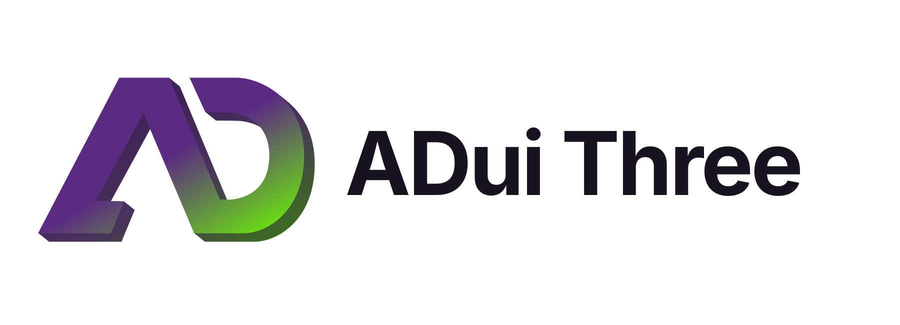

# ADui Three



统一 WebGL / WebGPU 场景创建、生命周期与资源管理，保留原生 scene、camera、renderer，并通过独立入口组合 Three.js 能力。

> [!NOTE]
> 当前版本 0.0.0，尚未发布 npm。通过工作区或本地 tarball 接入。Three.js peer 为 >=0.187.0 <0.188.0，实现基于 0.187.0，提供 ESM 与 TypeScript 声明。

## 接入

应用直接依赖 three@0.187.0；导入原生类型时另声明 @types/three@0.187.0。本地构建与 tarball 安装见 [安装指南](https://github.com/adui-studio/adui-three/blob/main/docs/guide/installation.md)。容器必须有明确宽高。

```ts
import { ThreeApp } from "@adui/three";
import { attachOrbitControls } from "@adui/three/controls";
import { BoxGeometry, Mesh, MeshNormalMaterial } from "three";

const app = await ThreeApp.create(container, {
  renderer: { type: "webgpu", allowFallback: true, antialias: true },
});
const cube = new Mesh(
  app.resources.track(new BoxGeometry()),
  app.resources.track(new MeshNormalMaterial()),
);
app.scene.add(cube);
app.camera.lookAt(0, 0, 0);
attachOrbitControls(app);
app.onUpdate(({ delta }) => {
  cube.rotation.y += delta;
});
app.start();
```

将 renderer.type 改为 webgl 即选择 WebGLRenderer；省略 renderer 也默认 WebGL。创建不自动启动，start / stop 控制连续渲染，renderOnce 在暂停时绘制一帧，卸载时等待完整清理：

```ts
await app.destroy();
```

geometry、material、texture 分别登记；宿主不会递归接管借用资源。模型、控件和效果句柄自行登记生命周期。新接入使用 ThreeAppCreateOptions；同步 new ThreeApp 保留给已有 WebGL 用法。

## 扩展组合

```ts
import { attachPostprocessing } from "@adui/three/postprocessing";

const effects = attachPostprocessing(app, {
  bloom: { strength: 1, threshold: 0.85 },
  outline: { selectedObjects: [cube] },
  colorAdjustment: { saturation: 0 },
});
effects.configure({ bloom: { strength: 2, threshold: 0.85 } });
// effects.dispose();
```

WebGL / WebGPU 共用这些函数与配置。原生 pass、node、material 仍保留各后端的具体类型，不直接互换；正式参数调整使用 configure。WebGPU 默认允许原生 WebGL 2 回退，严格设备验证使用 allowFallback:false。rendererType 表示渲染器族，backend 表示实际图形 API。正交宿主目前只支持 WebGL。

## 公开入口

| 入口                       | 能力                                           |
| -------------------------- | ---------------------------------------------- |
| @adui/three                | ThreeApp、OrthographicThreeApp、ResourceScope  |
| @adui/three/controls       | 轨道控件、变换手柄                             |
| @adui/three/loaders        | GLTF/GLB、压缩解码、模型实例                   |
| @adui/three/animation      | 动画播放、混合、定位、路径运动                 |
| @adui/three/camera         | 取景、过渡、视角快照                           |
| @adui/three/interaction    | 拾取、点击与悬停                               |
| @adui/three/labels         | DOM 标签投影与挂载                             |
| @adui/three/geometry       | 边界、路径几何、实例化                         |
| @adui/three/collision      | 静态 BVH 碰撞世界                              |
| @adui/three/navigation     | 第一/第三人称导航                              |
| @adui/three/effects        | 飞线、流光、飞点、光墙、雷达、波纹、光柱、护罩 |
| @adui/three/lighting       | 方向光与 Basic/PCF/VSM 阴影                    |
| @adui/three/rendering      | 色调映射、曝光、Editor 预设                    |
| @adui/three/postprocessing | 泛光、选择描边、颜色滤镜                       |
| @adui/three/environment    | HDR/EXR、Room PMREM、环境绑定                  |
| @adui/three/textures       | 图片与独立 KTX2 纹理                           |
| @adui/three/capture        | 画布截图、区域裁剪、编码取消                   |

内部 src 路径不是公开 API。模块可以在无 DOM 环境导入，创建宿主需要浏览器。

## 文档与示例

- [使用指南](https://github.com/adui-studio/adui-three/blob/main/docs/guide/getting-started.md)
- [渲染器配置与设备范围](https://github.com/adui-studio/adui-three/blob/main/docs/api/webgpu.md)
- [API 参考](https://github.com/adui-studio/adui-three/blob/main/docs/api/index.md)
- [正式示例](https://github.com/adui-studio/adui-three/blob/main/examples/README.md)
- [生命周期与所有权](https://github.com/adui-studio/adui-three/blob/main/docs/guide/lifecycle.md)
- [实际验收记录](https://github.com/adui-studio/adui-three/blob/main/docs/HARNESS.md)
